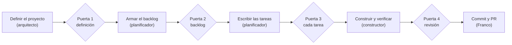
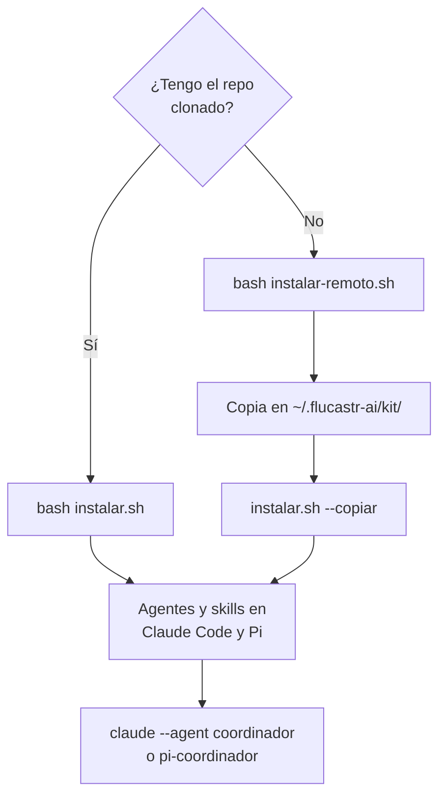

<p align="center"></p>

# Flucastr.AI

Mi forma de construir productos con agentes de IA, sin enredarme en la herramienta.

> Estado: en uso (2026-10-30). El kit completo (arquitecto, coordinador, planificador y constructor, con instalador local y remoto) está hecho; el avance real está en `definitions/BACKLOG.md`.

## La idea

Flucastr.AI es un kit personal de agentes, skills e instaladores para trabajar con IA en Claude Code y Pi. Yo abro un solo agente, el `coordinador`, y él reparte el trabajo entre un `arquitecto`, un `planificador` y un `constructor`. Todo pasa por archivos que puedo leer y por cuatro puertas donde yo apruebo antes de seguir. Los agentes no hacen commit, push, PR ni despliegue: eso es mío.

No es un servicio ni una aplicación: es texto (agentes y skills), unos scripts y las pruebas que comprueban que el kit hace lo que dice.

## Para qué existe

Para producir funcionalidad real en mis proyectos (Don Financio, Andes y otros) trabajando con agentes de IA, sin quedar de mensajero entre sesiones y sin que armar la herramienta consuma la jornada.

## Reglas

1. **Producto primero.** Lo primero que se construye es algo que me sirva, no una herramienta.
2. **Una tarea, un archivo.** Cada trabajo se describe en un archivo de tarea; yo lo apruebo antes de que se escriba código.
3. **Yo hago el commit.** Los agentes no hacen commit, push, PR, merge ni despliegue. El `constructor` solo crea la rama de la feature (`git switch -c`) y, con mi confirmación, se cambia a una rama existente (`git switch`); el commit, el PR, el merge y el despliegue son míos. Tampoco en el modo yolo: ahí los cambios quedan sin commit en la rama actual para que yo los revise.
4. **Los secretos no se tocan.** Nadie lee ni imprime `.env`, llaves ni credenciales.
5. **Nada nuevo sin dolor real.** Una herramienta, regla o automatización se agrega solo cuando su ausencia ya me costó tiempo.
6. **Corte duro.** Si en 2 o 3 días no hay algo funcionando, paro y reviso qué me frena.

## Documentación

La definición vigente del proyecto está en [`definitions/`](definitions/):

- [`PROJECT.md`](definitions/PROJECT.md): qué es, cómo se prueba, decisiones, flujo de trabajo y preguntas abiertas.
- [`REPOS.md`](definitions/REPOS.md): repos y conexiones.
- [`ARCHITECTURE.md`](definitions/ARCHITECTURE.md): estructura, diagrama y evolución prevista.

[`AGENTS.md`](AGENTS.md) es la entrada breve para cualquier agente. Todo es borrador hasta que lo apruebo.

## Cómo se usa

1. Instalo el kit (ver [Instalación](#instalación)) y abro el coordinador desde la carpeta de mi proyecto: `claude --agent coordinador` o `pi-coordinador`.
2. El `coordinador` mira qué falta y delega: sin definición llama al `arquitecto`; con definición aprobada y sin backlog, al `planificador`; con tareas aprobadas, al `constructor`.
3. Me detiene en cuatro puertas y ahí reviso y apruebo. Lo que decido queda escrito en `definitions/STATUS.md`.
4. Los commits, el PR y el despliegue los hago yo.



| Rol | Qué hace | Qué no hace |
|---|---|---|
| `coordinador` | Es el único que abro; decide el paso siguiente, delega y se detiene en las puertas. | Construir. |
| `arquitecto` | Define el proyecto, sus repos y su arquitectura. | Planificar o construir. |
| `planificador` | Escribe el backlog y descompone cada feature en tareas completas y acotadas. | Construir o aprobar. |
| `constructor` | Ejecuta una tarea aprobada, la verifica y deja la evidencia. | Marcar `hecha`, hacer commit, push, PR, merge o despliegue. |

Detalle del flujo, de la rama por feature, del refinado y del modo yolo en [`definitions/WORKFLOW.md`](definitions/WORKFLOW.md) y en la sección [Flujo](#flujo).

## Estructura

```
Flucastr.AI/
├── README.md
├── assets/         # logo del README
├── AGENTS.md        # entrada breve para agentes
├── definitions/     # definición vigente del proyecto
├── features/        # tareas por feature (features/Fxx-nombre/task-NN-nombre.md); las terminadas, archivadas en features/completed/
├── modelos.json     # niveles y modelos por herramienta, ventanas y compactar_en; los agentes declaran nivel, no modelo
├── agentes/         # un archivo por agente
│   ├── arquitecto.md    # define proyecto, estructura y arquitectura
│   ├── coordinador.md   # el único que abres; delega y se detiene en las cuatro puertas
│   ├── planificador.md  # redacta el backlog y las tareas
│   └── constructor.md   # ejecuta una tarea aprobada y deja la evidencia
├── skills/          # procedimientos que los agentes cargan solo cuando los necesitan
│   ├── definir-proyecto/
│   ├── revisar-proyecto-existente/
│   ├── disenar-arquitectura/
│   ├── generar-clonar/
│   ├── crear-backlog/
│   ├── descomponer-feature/
│   └── ejecutar-tarea/
├── scripts/
│   ├── resolver.mjs    # resuelve el modelo de cada agente, genera los archivos por herramienta y la compactación
│   ├── archivar.mjs    # chequea el contexto y, con --aplicar Fxx (Fxx explícito; lo corre Franco o el coordinador a su pedido, WORKFLOW.md §3.1), mueve esa feature hecha a features/completed/
│   ├── consumo.mjs     # mide consumo de tokens, turnos y KB leídos por rol desde los logs de Pi y Claude Code (solo lectura; lo corre Franco)
│   ├── informe.mjs    # informe de resultados del flujo desde registro/eventos.jsonl; con --consumo añade el bloque de consumo (lo corre Franco)
│   └── registrar.mjs   # registra los eventos del flujo en registro/eventos.jsonl (lo corre Franco)
├── pruebas/         # comprobaciones del kit y arnés de pruebas del arquitecto (ver pruebas/README.md)
├── instalar.sh      # instala agentes y skills en Claude Code y Pi
├── instalar-remoto.sh   # instala sin clonar el repo: descarga main de GitHub, verifica y actualiza
└── desinstalar.sh   # quita exactamente lo que instaló
```

Una comprobación (`pruebas/comprobaciones/readme-estructura.mjs`) falla si el árbol de agentes y skills de este bloque no coincide con `agentes/` y `skills/`.

## Instalación

Hay dos caminos: **con el repo clonado** (mi equipo principal) y **sin clonar** (el PC de trabajo, donde no tengo clon). Los dos terminan igual: agentes y skills instalados para Claude Code y Pi.



### Con el repo clonado

```bash
bash instalar.sh --simular   # valida y muestra qué haría, sin escribir nada
bash instalar.sh             # instala (Claude Code y Pi, los que encuentre)
bash desinstalar.sh          # quita lo instalado

# Dejar al arquitecto como agente predeterminado de un proyecto (cada sesión ahí arranca con él):
bash instalar.sh --proyecto /ruta/al/proyecto

# Copiar las skills de Pi dentro del proyecto (para Pi cuando se abre desde el workspace):
bash instalar.sh --proyecto /ruta/al/proyecto --skills-proyecto   # copia las skills a <proyecto>/.pi/skills/ (para Pi en el workspace)

# Quitar solo ese ajuste de un proyecto, sin desinstalar lo demás:
bash desinstalar.sh --proyecto /ruta/al/proyecto
```

- Las skills se **enlazan** desde `skills/`; el agente de Claude Code se **genera** con el `model` tomado de `modelos.json`; para Pi se genera el agente en `~/.pi/agent/agents/` (lo lee el paquete de subagentes) y un lanzador `pi-<agente>`.
- Valida todo antes de tocar nada y nunca pisa archivos que ya existan: los omite y lo avisa.
- Si cambias `modelos.json`, vuelve a correr `bash instalar.sh` (el lanzador de Pi lo lee en vivo; el agente de Claude Code no). El nivel de cada agente lo eliges tú en ese archivo.
- `--proyecto` escribe `{"agent": "arquitecto"}` en `<proyecto>/.claude/settings.local.json`. No pisa un agente que el proyecto ya tenga definido, y `desinstalar.sh` lo deshace.
- `--agente <nombre>` elige el agente predeterminado del proyecto (por defecto `arquitecto`).
- Deja puesta la compactación automática en Pi y, con `--proyecto`, en Claude Code; ver [Higiene de contexto y compactación](#higiene-de-contexto-y-compactación).
- Uso: `claude --agent coordinador` o `pi-coordinador`, desde la carpeta del proyecto (también `arquitecto`, `planificador` y `constructor` por separado).
- `--skills-proyecto` (con `--proyecto`) copia las skills a `<proyecto>/.pi/skills/` como carpetas reales, sin enlaces, para que Pi las lea desde el workspace. Nunca enlaza ni pisa una carpeta que no sea de Flucastr.AI: la omite y lo avisa. No se combina con `--solo claude`.
- Las copias quedan fuera de git del proyecto: cada una se añade a `.git/info/exclude` (no al `.gitignore`). No se editan: se rehacen al volver a correr `bash instalar.sh` o `instalar-remoto.sh --actualizar`. Con `--solo claude` las copias de los proyectos registrados se borran y no se rehacen; el registro se conserva, y `bash instalar.sh --proyecto <ruta> --skills-proyecto` las vuelve a crear.
- Pi pide confiar en el proyecto (`/trust`) la primera vez que lo abre. El instalador no cambia esa confianza.
- `--proyecto` deja `.claude/settings.local.json` sin ignorar en git: el proyecto lo muestra como no versionado (`?? .claude/`). `desinstalar.sh --proyecto <ruta>` quita ese ajuste, las copias de skills y sus líneas en `.git/info/exclude`.

### Sin clonar el repo (PC de trabajo)

En el PC de trabajo no tengo clon. Ahí uso `instalar-remoto.sh`, que baja la versión publicada de `main` (o la de `--ref`), la verifica y corre `instalar.sh --copiar` sobre una copia en `~/.flucastr-ai/kit/`. Lo que recomiendo es bajarlo, leerlo y correrlo en dos pasos:

```bash
curl -fsSL https://raw.githubusercontent.com/francolmc/Flucastr.AI/main/instalar-remoto.sh -o instalar-remoto.sh
cat instalar-remoto.sh     # lo leo antes de correrlo
bash instalar-remoto.sh
```

La forma de una línea, si ya lo leí y confío en el repo:

```bash
curl -fsSL https://raw.githubusercontent.com/francolmc/Flucastr.AI/main/instalar-remoto.sh | bash
```

Después de la primera instalación, lo manejo desde la copia que quedó en el kit:

```bash
bash ~/.flucastr-ai/kit/instalar-remoto.sh --estado                # compara la instalada con la publicada; no descarga
bash ~/.flucastr-ai/kit/instalar-remoto.sh --actualizar            # trae la versión publicada si cambió
bash ~/.flucastr-ai/kit/instalar-remoto.sh --ref <rama|tag|sha>    # fija otra versión; también sirve para volver atrás
```

- Volver a correr el comando sin opciones hace lo mismo que `--actualizar`: si ya está al día, lo dice y no toca nada.
- La actualización es atómica: si algo falla a mitad, vuelve la versión anterior y `version` no cambia. No hay procesos en segundo plano ni avisos automáticos; lo corro yo cuando quiero.
- Dónde vive todo: `~/.flucastr-ai/kit/` es la copia de la versión instalada (se reemplaza al actualizar; no la edito); `~/.flucastr-ai/version` guarda el sha, la fecha y la rama o tag consultados.
- `~/.flucastr-ai/modelos.json` es mi `modelos.json` personal. Se crea la primera vez y **nunca se pisa**: al actualizar queda byte a byte igual.
- Si la versión publicada trae novedades en `modelos.json` (versión mayor, agente o perfil nuevo), el instalador lo avisa y no lo mezcla con el mío. Para compararlos: `diff ~/.flucastr-ai/modelos.json ~/.flucastr-ai/kit/modelos.json`.
- Para quitar todo: `bash ~/.flucastr-ai/kit/desinstalar.sh`. Conserva mi `modelos.json`; con `--todo` también lo borra.
- Requisitos: `bash`, `curl`, `tar` y `node`.
- Riesgo asumido de `curl | bash`: quien controle la cuenta de GitHub controla lo que se ejecuta en este PC. Mitigación prevista: 2FA en la cuenta y `main` con PR obligatorio; por eso la forma de dos pasos va primero.

Si Pi está en el workspace de ese PC, el flag de skills de proyecto también funciona: `bash ~/.flucastr-ai/kit/instalar.sh --copiar --proyecto <ruta> --skills-proyecto`, y `--actualizar` rehace esas copias. Pendiente de comprobar en el PC de trabajo: si Pi lee las skills desde .pi/skills/ ahí.

#### Comprobación manual en el PC de trabajo

Esto no lo pueden hacer los agentes ni las pruebas: necesita la red real y ese equipo. Lo hago yo, en este orden:

1. Comprobar que la red llega a `raw.githubusercontent.com`, `api.github.com` y `codeload.github.com`.
2. Correr el comando de una línea y arrancar `claude --agent arquitecto` o `pi-arquitecto`, con el modelo que indica mi `modelos.json`.
3. Editar mi `modelos.json`, publicar un cambio mínimo en `main` (una frase en una skill), correr `--estado` (debe decir «hay versión nueva»), luego `--actualizar`, y comprobar que el cambio llegó y que mi `modelos.json` sigue igual.
4. Ver si la política de la empresa permite instalar agentes de IA de este tipo.
5. Probar `desinstalar.sh` en el PC de trabajo.

## Pruebas

```bash
node --test --test-concurrency=1 pruebas/comprobaciones/*.test.mjs pruebas/*.test.mjs
node --test --test-concurrency=1 pruebas/capa1/instalacion.test.mjs
```

Detalle de escenarios y permisos en [`pruebas/README.md`](pruebas/README.md).

## Flujo

El `coordinador` (el único agente que abro) invoca al `arquitecto`, al `planificador` y al `constructor`, y se detiene en cuatro puertas de aprobación: definición, backlog, cada tarea y revisión del resultado. Detalle en [`definitions/WORKFLOW.md`](definitions/WORKFLOW.md). Cada feature trabaja en una rama `feature/`, `fix/` o `chore/` + `Fxx-nombre`; al quedar `hecha` su última tarea, el aviso llega por `STATUS.md` para que yo cierre la rama. Antes de descomponer una feature ambigua puede haber un refinado previo (hasta 5 preguntas con recomendación en `features/Fxx/refinado.md`), solo cuando se requiere. Solo si lo pido de forma explícita en la conversación (por ejemplo «yolo F05»), con el alcance nombrado, la definición aprobada y un único repo, existe el modo yolo: el `coordinador` omite las puertas 2, 3 y 4, trabaja directo en la rama actual (con una advertencia si es `main`) y se detiene ante cualquier escalación o si una feature necesita refinado. Detalle en `definitions/WORKFLOW.md` §9.3.

## Higiene de contexto y compactación

### Por qué

El estado del flujo vive en `definitions/STATUS.md` y en los archivos de cada feature, no en la conversación. Así una sesión que se corta no pierde el hilo. Pero un contexto largo cuesta más en cada turno, porque la herramienta reenvía todo lo acumulado, y con más contexto el modelo tiende a derivar. Medido en Pi (*inferido*): unas 2,4 veces más costo por turno con 130 k de contexto que con 25 k. Por eso el kit deja puesta la compactación automática: cuando el contexto llega al umbral, la herramienta lo resume sola. No tengo que teclear nada, tampoco desde el celular.

### Qué deja puesto el kit

- **Pi**: en `~/.pi/agent/settings.json` (o `$PI_CODING_AGENT_DIR/settings.json`), un ajuste global `compaction.modelOverrides["<proveedor>/<modelo>"].reserveTokens` con el valor `ventana − compactar_en`. Con ventana 272000 y `compactar_en` 100000, queda `172000` para `openai/gpt-6-astra`, `openai/gpt-6.1-sol` y `openai/gpt-6-luna`. Es global: también aplica a esos modelos fuera del kit.
- **Claude Code**: solo con `--proyecto`, en `<proyecto>/.claude/settings.local.json`, con `autoCompactWindow = compactar_en + 33000` (`133000`). Claude Code guarda 33.000 tokens de colchón antes de su límite de compactación, así que ese valor hace que compacte cerca de `compactar_en`. Sin `--proyecto` el kit no toca Claude Code.

### Mecanismos por herramienta

Versiones verificadas: Pi 1.4.0 y Claude Code 2.1.308. Codex: pendiente, todavía no tiene compactación verificada en el kit.

| | Pi 1.4.0 | Claude Code 2.1.308 |
|---|---|---|
| Compactación automática | Sí, al superar `ventana − reserveTokens` | Sí, según `autoCompactWindow` |
| Dónde se configura | `compaction.modelOverrides` en `~/.pi/agent/settings.json`, lo pone `instalar.sh` | `autoCompactWindow` en `<proyecto>/.claude/settings.local.json`, solo con `--proyecto` |
| Fórmula | `reserveTokens = ventana − compactar_en` (172000) | `autoCompactWindow = compactar_en + 33000` (133000) |
| Rango y validación | Enteros no negativos. Un valor inválido en el modelo activo detiene Pi | Entre 100000 y 1000000. Fuera de rango se ignora en silencio |
| Cuándo se aplica | Al abrir Pi de nuevo o con `/reload` (no relee en caliente) | Al abrir una sesión nueva |
| Sesión nueva a mano | `/new` | `/clear` |
| Compactar a mano | `/compact` | `/compact` |
| Medir | Pie del TUI y `/session`; `showCacheMissNotices: true` | `/context`, donde aparece `Autocompact buffer 33k` |

### Cambiar el umbral

Edita `compactar_en` en `modelos.json` (y `ventanas` si cambias de modelo) y corre `bash instalar.sh`. Pi se rehace solo con los valores nuevos.

En Claude Code, un proyecto ya instalado conserva el valor que tiene. Para cambiarlo, quita primero el ajuste con `bash desinstalar.sh --proyecto <ruta>` y vuelve a instalar con `bash instalar.sh --proyecto <ruta>`.

### Qué respeta

El kit nunca pisa lo que ya definiste. En Pi respeta `compaction.enabled`, `compaction.reserveTokens` y cualquier `modelOverrides` del mismo modelo; en Claude Code respeta un `autoCompactWindow` que ya tenga el proyecto. Si encuentra uno, lo omite y lo avisa con `OMITIDO`.

Escribe con un bloqueo `settings.json.lock` y con escritura atómica. `bash instalar.sh --simular` muestra qué haría sin escribir nada. `bash desinstalar.sh` quita solo lo suyo: borra una clave únicamente si su valor sigue siendo el que puso el kit.

### Después de instalar, comprobar

1. Abre Pi de nuevo o ejecuta `/reload`. Pi no relee `settings.json` en caliente.
2. Compara `~/.pi/agent/settings.json` con la copia que tenías antes (`diff`). Solo debe aparecer `compaction.modelOverrides` para los modelos del kit; el resto del archivo debe quedar igual.

### Limitaciones

- En Pi el ajuste es global: compacta también cuando uso esos modelos fuera del kit, a unos 100 k.
- Compactar pierde el razonamiento intermedio y las salidas de subagentes que no quedaron anotadas. Por eso el `coordinador` escribe `STATUS.md` antes de delegar: el estado del flujo sobrevive a la compactación.
- Un `modelos.json` personal antiguo, sin `compactar_en` ni `ventanas`, no instala nada. Al actualizar, el comparador de `modelos.json` avisa «campo nuevo».
- Un modelo sin ventana declarada, o con `ventana − compactar_en` menor que 16384, se omite con aviso; Pi usa entonces su valor por defecto.

## Medición de consumo

Mido cuánto consume cada rol (tokens, turnos y KB leídos) a partir de los logs que dejan Pi y Claude Code. Lo corro yo, desde la raíz del proyecto:

`node scripts/consumo.mjs --raiz <carpeta de logs> [--hasta <ISO>] [--tareas <n>] [--json]`

Los logs de Pi están en `~/.pi/agent/sessions/--<proyecto>--/` y los de Claude Code en `~/.claude/projects/<proyecto>/`. Mido el costo, los turnos por tipo y por tramo de contexto, las llamadas a subagentes (`subagents_enable`) y los KB leídos por rol. En Claude Code el costo sale `n/d`. Solo cuento lecturas hechas con la herramienta `read`; lo que se leyó con `bash` no se mide. No imprimo el texto de los mensajes y no escribo ni modifico archivos. `--hasta` no se aplica a los subagentes de Claude Code.

## Registro de eventos

Junto datos de cada ejecución del flujo para detectar errores y mejorar cómo trabajo con los agentes. El informe que lo resume existe: `node scripts/informe.mjs [--consumo <carpeta de logs>] [--minimo <n>] [--json]`. Lo corro yo tras `registrar.mjs`; escribe `registro/informe.md` (ignorado por git) y lo imprime. Bajo 10 tareas con datos (o bajo `--minimo`) solo da conteos, sin porcentajes ni medianas. Con `--consumo <carpeta>` añade el bloque «Consumo (aproximado)», con costo y turnos totales y por rol, leídos con `consumo.mjs`; sin esa bandera el informe no cambia. `--json` agrega la clave `consumo` con los mismos números.

Lo corro yo, desde la raíz del proyecto, con `node scripts/registrar.mjs`: las veces que quiera y antes de archivar. `--reconstruir` regenera todo el archivo desde cero y `--raiz <dir>` lo apunta a otra raíz.

Produce `registro/eventos.jsonl`. Esa carpeta tiene su propio `.gitignore`, se puede regenerar y no guarda datos personales ni texto libre. Lee solo lo que está en commits, así que lo que no está commiteado no aparece: el historial de las tareas, de `BACKLOG.md` y de `STATUS.md`, y las líneas `Registro:` que el `constructor` agrega a *Notas*.

El modelo que queda registrado es el que indica `modelos.json` al correr el script; conviene correrlo antes de cambiar de modelo.

## Archivo y rescate

El trabajo anterior (`project-flow`, `project-lite`, kit v1) vive en `claude-skills-personal` y no se toca. Si algo sirve, se rescata aquí cuando haga falta, no antes.

## Bitácora

- 2026-10-28: reinicio del proyecto y nombre `Flucastr.AI`. Se crean `modelos.json`, el arquitecto, sus cuatro skills y el instalador/desinstalador.
- 2026-10-29: la definición pasa a `definitions/`; se acota el alcance de las pruebas; se define el flujo con coordinador, planificador y constructor.
- 2026-10-29: existen coordinador, planificador y constructor; el README se actualiza a ese estado.
- 2026-10-29: F04 (README al día): el README refleja el kit real y `pruebas/comprobaciones/readme-estructura.mjs` comprueba su árbol de `## Estructura` contra `agentes/` y `skills/`.
