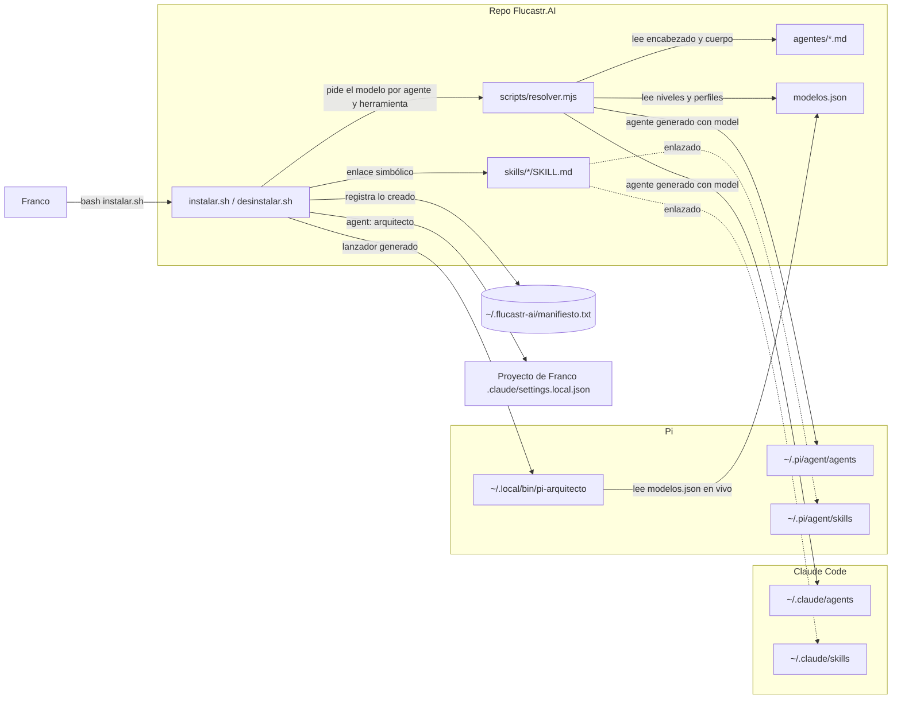

# Arquitectura — Flucastr.AI (modo: actual)

> Estado: **borrador** (2026-10-28). Describe cómo es **hoy**. Lo que mejoraría va solo en «Observaciones».

## Estructura y su razón

Un solo repo, `Flucastr.AI`. Es un kit de configuración y scripts, sin servicio en ejecución, sin base de datos y sin despliegue (confirmado, `repos.md`). Una sola unidad se instala en la máquina de Franco; separar repos no tendría razón concreta.

## Diagrama

## Componentes

| Componente | Responsabilidad | Tecnología | Origen del dato |
|---|---|---|---|
| `agentes/` | Define cada agente (nombre, descripción, instrucciones). No declara modelo. | Markdown con encabezado | `agentes/arquitecto.md`; el resolver rechaza `model:` |
| `skills/` | Procedimientos que el agente carga solo al llegar a ese paso. | Markdown con encabezado | `skills/*/SKILL.md` |
| `modelos.json` | Fuente única de modelos: niveles, respaldo, perfiles por herramienta, nivel por agente. | JSON | `modelos.json` |
| `scripts/resolver.mjs` | Resuelve nivel→perfil→modelo; genera agentes por herramienta; fija y quita el agente de un proyecto. | Node ESM | `scripts/resolver.mjs` |
| `instalar.sh` | Enlaza skills, genera agentes y lanzador de Pi, escribe manifiesto. Nunca pisa lo existente. | Bash | `instalar.sh` |
| `desinstalar.sh` | Quita solo lo que figura en el manifiesto; los archivos generados solo se borran si conservan la marca `flucastr-ai:generado`. | Bash | `desinstalar.sh` |
| Destinos Claude Code / Pi | Donde cada herramienta lee agentes y skills. | Carpetas en `~` | `instalar.sh` (rutas); **no verificado** que Pi lea `agents/` sin su paquete de subagentes |

## Decisiones

El repo no registra el «por qué» de estas decisiones; lo de abajo es **inferido** del código y marcado así.

| Decisión | Por qué | Descartado y por qué | Qué la cambiaría |
|---|---|---|---|
| Los agentes declaran **nivel**, no modelo | Cambiar de modelo o proveedor se hace en un solo archivo (`_leeme` de `modelos.json`, confirmado) | Modelo en cada agente: no documentado | Que el usuario deje de querer manejar los modelos |
| Skills **enlazadas**, agentes **generados** | Skills iguales en ambas herramientas; los agentes necesitan el modelo resuelto (inferido) | Copiar todo: no documentado | Que una herramienta no siga enlaces o cambie su formato |
| Manifiesto + marca de archivo generado | Desinstalar exactamente lo instalado (confirmado, `README.md`) | No documentado | — |
| Skills cargadas bajo demanda | Mantener el agente corto (confirmado, `arquitecto.md`) | No documentado | — |
| Un solo repo | Es lo más simple que sirve (`arquitecto.md`, principio 5) | Varios repos: sin razón concreta | Que algo se despliegue o evolucione por separado |

## Supuestos y pendientes

- **Supuesto**: Pi lee los agentes de `~/.pi/agent/agents/` mediante un paquete de subagentes (comentario en `instalar.sh`).
- **Pendiente**: URL del remoto y visibilidad.
- **Pendiente**: si `instalar.sh` ya se corrió en esta máquina.
- **Pendiente**: sin pruebas, solo existe `--simular` como verificación.

## Observaciones

Mejoras posibles. **No forman parte del diagrama** y no están decididas.

1. **Falta el eslabón «terminar»** (confirmado por Franco). Hoy el kit llega hasta definir y diseñar. No existe nada que lleve una feature hasta *hecha*: tarea con criterios de aceptación, quién construye y cómo se comprueba que quedó terminada.
2. **Los tamaños básico / medio / robusto no existen aún** en el kit. Hoy `disenar-arquitectura` ya decide uno o varios repos (por defecto uno), pero nada ajusta el rigor del trabajo según el tamaño.
3. **La neutralidad entre agentes ya está bien encaminada**: los agentes y skills son Markdown con encabezado y no dependen de la herramienta. Para mantenerla, las nuevas herramientas deben ser Markdown más scripts, sin rasgos propios de una sola herramienta.
4. **Sin remoto ni commits del kit**: todo menos dos commits está sin versionar. Conviene versionar antes de agregar más.
5. **Texto desactualizado**: `arquitecto.md` dice «nivel alto» y `modelos.json` dice medio. Franco indicó no cambiar el modelo; la frase de `arquitecto.md` podría quitarse en el futuro para que no contradiga al archivo de modelos (decisión suya).
6. **Sin pruebas** del resolver ni del instalador.

## Estado

Borrador.
