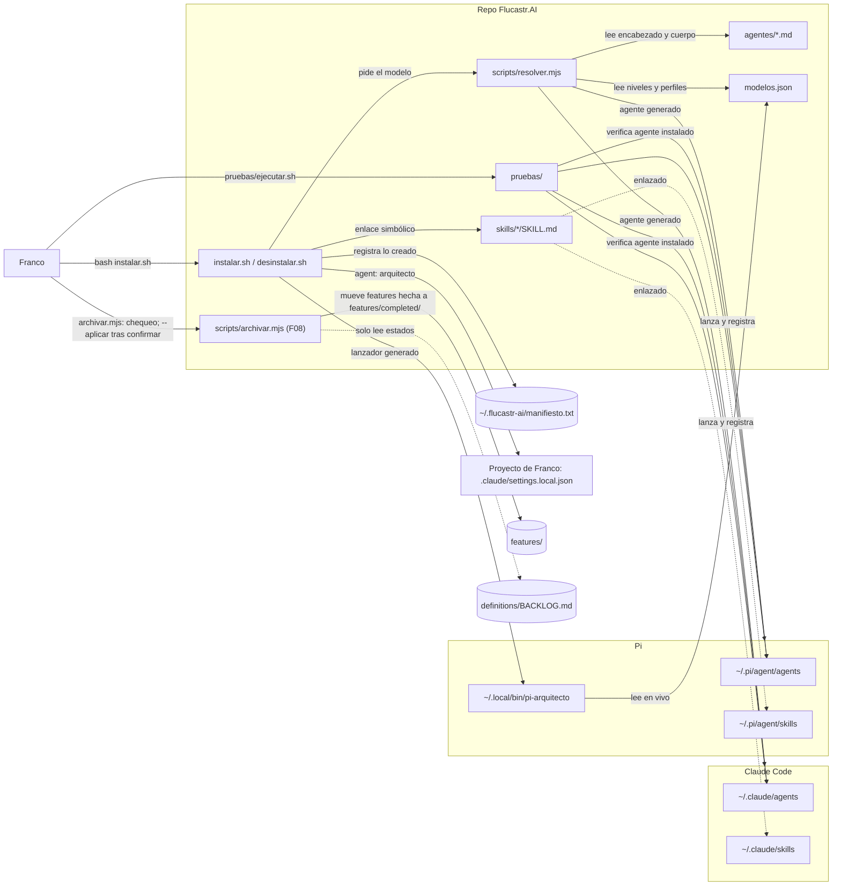
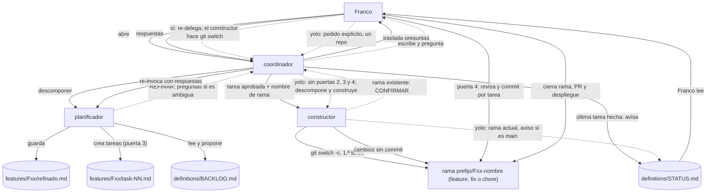
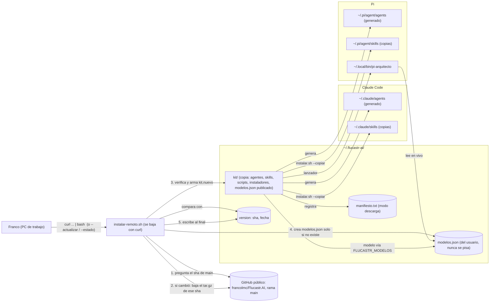

# Arquitectura — Flucastr.AI (modo: actual)

> Estado: **aprobado** (2026-10-29; incluye los cambios de F05 y F06). Puerta 1 de F08 aprobada el 2026-10-30 (`scripts/archivar.mjs`). **Pendiente de aprobación:** `WORKFLOW.md` §10.5 (el `coordinador` no corre el script; lo corre Franco) y **F09, instalación sin clon desde GitHub** (sección «Instalación sin clon…», borrador del 2026-10-30; puerta 1).

## Estructura y su razón

Un solo repo, `Flucastr.AI`: configuración, scripts y pruebas. Sin servicio en ejecución, sin base de datos y sin despliegue (confirmado, `REPOS.md`). Se instala en la máquina de Franco; separar repos no tiene razón concreta. *(F09, por aprobar: además puede instalarse sin clon, descargando desde GitHub; sigue siendo un solo repo y un solo árbol de archivos.)*

## Diagrama

## Componentes

| Componente | Responsabilidad | Tecnología | Origen |
|---|---|---|---|
| `agentes/` | Define cada agente. No declara modelo (el resolver rechaza `model:`). | Markdown con encabezado | `agentes/arquitecto.md`, `definicion/plan-pruebas-arquitecto.md` (I6) |
| `skills/` | Procedimientos que el agente carga por paso. | Markdown con encabezado | `skills/*/SKILL.md` |
| `modelos.json` | Fuente única de modelos: niveles, respaldo, perfiles, nivel por agente. | JSON | `modelos.json` |
| `scripts/resolver.mjs` | Resuelve nivel→perfil→modelo y genera los agentes por herramienta. | Node ESM | `README.md`, `definicion/arquitectura.md` |
| `scripts/archivar.mjs` (F08) | Chequeo de contexto de solo lectura; con `--aplicar` mueve a `features/completed/` las features `hecha` con todas sus tareas `hecha`. Ambos modos los corre Franco; el `coordinador` no tiene Bash y solo deja el comando en `STATUS.md`. Nunca escribe estados ni borra. | Node ESM, sin dependencias | `WORKFLOW.md` §10 |
| `instalar.sh` | Valida primero y después enlaza skills, genera agentes y lanzador de Pi, escribe manifiesto. Nunca pisa lo existente. | Bash | `instalar.sh` (cabecera y comentario de validación) |
| `desinstalar.sh` | Quita solo lo del manifiesto; borra generados únicamente si conservan la marca `flucastr-ai:generado`. | Bash | `README.md`, `definicion/arquitectura.md` |
| `pruebas/` | Capa 1 (instalación) y escenarios B, M, R con modelo; fixtures generados, remotos *bare* locales, comprobaciones duras con control negativo, registro estructurado e instantánea. | Bash + Node (`node --test`) | `pruebas/README.md`, `pruebas/ejecutar.sh` |
| Destinos Claude Code / Pi | Donde cada herramienta lee agentes y skills. | Carpetas en `~` | `instalar.sh`; que Pi lea `agents/` sin su paquete de subagentes **no está verificado** |

## Decisiones

| Decisión | Por qué | Descartado y por qué | Qué la cambiaría |
|---|---|---|---|
| Skills **enlazadas**, agentes **generados** (modo desarrollo, con clon) | Skills idénticas en ambas herramientas; el agente necesita el modelo resuelto (inferido); con clon, editar la skill se ve al instante | Copiar todo: no documentado | Que una herramienta no siga enlaces o cambie su formato |
| Skills **copiadas** en el modo descarga (F09, por aprobar) | Sin clon no hay a qué enlazar; Franco lo pidió | Enlaces a `~/.flucastr-ai/kit/` (enlace roto si falla un reemplazo) | Que en el PC de trabajo se quiera editar skills en sitio |
| Dos modos de instalación que no se mezclan (F09, por aprobar) | Una sola fuente de qué hay instalado (`manifiesto` con línea `modo`) | Un solo modo copiando siempre (pierde la edición en vivo en desarrollo) | Que Franco deje de desarrollar con clon |
| Manifiesto + marca de generado | Desinstalar exactamente lo instalado (`README.md`) | No documentado | — |
| Validar antes de actuar | Un `modelos.json` roto dejaba una instalación parcial o destruía la previa (defecto confirmado por la Capa 1 y corregido) | Validar al final | — |
| Pruebas contra el agente **instalado** | Es lo que Franco usa (`plan-pruebas-arquitecto.md`); el ejecutor se detiene si el instalado es el antiguo | Probar los archivos del repo | — |
| Skills bajo demanda | Mantener corto el agente | Todo en el agente | — |
| Archivar con script, bajo confirmación de Franco (F08) | Mantiene corto lo que leen los agentes sin que un agente mueva carpetas ni decida estados | Que el `coordinador` mueva carpetas o corra el script (exigiría darle Bash; Franco lo descartó el 2026-10-30); mover tareas sueltas (rompe `depende_de:`); segundo archivo de estado para lo archivado (dos fuentes de verdad) | Que el costo de contexto de `features/` siga siendo bajo sin archivar |

## Evolución prevista (no existe hoy)

Tres roles más y un coordinador: `coordinador` (agente principal, delgado), `planificador` (backlog y tareas) y `constructor` (ejecuta una tarea). Franco abre solo el `coordinador`, que invoca a los demás como subagentes y se detiene en cuatro puertas de aprobación. Los roles se traspasan trabajo por archivos: `definitions/` → `definitions/BACKLOG.md` → `features/F01-nombre/task-NN-nombre.md` → `features/completed/`, con `definitions/STATUS.md` para el estado del flujo y los bloqueos. Ningún rol llama a otro: los bloqueos pasan por `STATUS.md`. Detalle en `PROJECT.md`, «Flujo de trabajo». El diagrama de arriba muestra la instalación del kit; el flujo de trabajo se dibuja aparte, en la sección siguiente. El arquitecto deja de ser el agente principal (cambio de una frase en `agentes/arquitecto.md`, de Franco).

## Flujo de trabajo con ramas, refinado y yolo (propuesta, F05 y F06)

Detalle y reglas en `WORKFLOW.md` §9. Es el flujo de los roles sobre archivos, no un componente instalado.

Las flechas punteadas son opcionales: el refinado solo si la feature lo requiere (criterio en `WORKFLOW.md` §9.2); yolo solo a pedido de Franco, sin crear rama (trabaja en la actual, con advertencia en `STATUS.md` si es `main`). El git de escritura de un agente es `git switch -c` del `constructor` en la primera tarea y, si la rama ya existe, `git switch <rama>` solo tras la confirmación de Franco (línea `CONFIRMAR:` vía `coordinador` y `STATUS.md`, `WORKFLOW.md` §9.1); Franco hace los commits, el PR y el despliegue (decidido 2026-10-29).

## Instalación sin clon desde GitHub (propuesta, F09)

> **Cambio por aprobar (puerta 1 de F09).** Decidido por Franco (2026-10-30): el instalador descarga desde `francolmc/Flucastr.AI` y copia a las herramientas; el repo pasa a público (lo hace Franco). *Recomendación mía, por aprobar:* todo lo que sigue sobre rama, versión y actualización. Hoy sigue vigente la instalación desde un clon (sección «Diagrama»): este flujo la **complementa**, no la reemplaza. El PC de trabajo usa solo el modo descarga; el PC de desarrollo (con clon) conserva los enlaces simbólicos, porque ahí se edita y se ve el cambio al instante.

### Diagrama

### Qué se publica y cómo se descarga

- **Qué se publica:** la rama `main` del repo. No hay release ni empaquetado: lo que Franco mergea (PR, puerta 4) es lo que se instala. Para poder fijar una versión, el comando acepta `--ref <rama|tag|sha>` (también sirve de marcha atrás). *Descartado:* releases por etiqueta (un paso manual más, que se olvida y deja versiones viejas sin avisar); `zip` (el `tar.gz` hace lo mismo y `tar` ya está donde hay `bash`). *Lo cambiaría:* que `main` reciba trabajo a medias, o que Franco quiera decidir cuándo llega algo al PC de trabajo; entonces se pasa a etiquetas.
- **Orden de la descarga (sin `git`, con `curl` y `tar`):** (1) `GET api.github.com/repos/francolmc/Flucastr.AI/commits/main` con `Accept: application/vnd.github.sha` devuelve el sha de 40 caracteres; (2) `GET codeload.github.com/francolmc/Flucastr.AI/tar.gz/<sha>`. Se descarga **el sha fijado en el paso 1**, no `main`, para no mezclar versiones si alguien publica entre las dos llamadas. API sin autenticar: 60 consultas/hora por IP (suficiente; si la red corporativa comparte IP y falla, el script lo dice y ofrece `--ref <sha>`).
- **Verificación mínima de integridad** (*recomendación*; los `tar.gz` de GitHub no tienen un hash publicado que comparar, así que **no hay autenticidad más allá de HTTPS y de la cuenta de GitHub**): HTTPS; `curl --fail` con tope de tiempo y de tamaño; el sha recibido coincide con `^[0-9a-f]{40}$`; antes de extraer se lista el archivo (`tar -tzf`) y se rechaza cualquier ruta absoluta o con `..`, o cualquier enlace simbólico; se extrae solo a una carpeta temporal nueva y vacía en `~/.flucastr-ai/tmp/`; se exigen `instalar.sh`, `modelos.json`, `agentes/*.md` y `skills/*/SKILL.md`; se aceptan solo estas rutas (lista permitida): `agentes/`, `skills/`, `scripts/`, `instalar.sh`, `desinstalar.sh`, `instalar-remoto.sh`, `modelos.json`. No se copian `pruebas/`, `definitions/`, `features/` ni `README.md`. Antes de tocar nada se valida con el `resolver` el `modelos.json` **del usuario** contra los agentes nuevos (misma regla que hoy: «validar antes de actuar»).
- **Riesgo asumido de `curl | bash`:** quien controle la cuenta de GitHub controla lo que se ejecuta en el PC de trabajo. Mitigación: 2FA en la cuenta, protección de `main` (PR obligatorio) y la forma alternativa de dos pasos (bajar `instalar-remoto.sh`, leerlo y correrlo), que la documentación ofrece primero.

### Cómo se copian agentes y skills sin enlaces simbólicos

- **Un solo lugar permanente, `~/.flucastr-ai/kit/`:** es la copia descargada y hace de «raíz» para los scripts (`RAIZ` en `instalar.sh`). Sin él, el lanzador de Pi (que lee `agentes/` y `scripts/resolver.mjs` en vivo) y `desinstalar.sh` no tendrían de dónde leer. Se descartó generar un lanzador que lleve el cuerpo del agente incrustado: obligaría a reinstalar para cada cambio y duplica lógica.
- **Skills:** `instalar.sh --copiar` hace `cp -R` de cada `skills/<n>/` a `~/.claude/skills/<n>/` y `~/.pi/agent/skills/<n>/`, y deja dentro un archivo vacío `.flucastr-ai` como marca. Mismas reglas de hoy: nunca pisa lo ajeno (si el destino existe y no tiene la marca, `OMITIDO`) y registra cada carpeta en el manifiesto con tipo nuevo `directorio`.
- **Agentes y lanzador:** igual que hoy (los genera el `resolver`, con la marca `flucastr-ai:generado`); el lanzador queda apuntando a `~/.flucastr-ai/kit`.
- **Manifiesto:** gana una línea `modo<TAB>descarga` (el modo desarrollo escribe `modo<TAB>repo`). `instalar.sh` se niega a cambiar de modo sobre una instalación del otro modo, con el mensaje de desinstalar primero (mezclar dejaría enlaces a un clon que `desinstalar.sh` del kit no reconoce).
- **Desinstalar:** `desinstalar.sh` quita las carpetas con marca, los agentes generados, el lanzador, `kit/`, `version` y el manifiesto; **conserva `~/.flucastr-ai/modelos.json`** salvo `--todo`.
- *Descartado:* mantener enlaces apuntando a `kit/` (Franco pidió copiar; además un enlace roto tras un `kit/` a medio reemplazar deja las herramientas sin skills).

### `modelos.json` local del usuario

- **Dónde:** `~/.flucastr-ai/modelos.json`, fuera de `kit/`, así que reemplazar `kit/` nunca lo toca. En la primera instalación se crea copiando el publicado; después **jamás se sobrescribe ni se edita**.
- **Cómo lo lee el código:** `scripts/resolver.mjs` usa la variable `FLUCASTR_MODELOS` si existe y, si no, `modelos.json` junto al repo (el modo desarrollo y todas las pruebas actuales no cambian). `instalar.sh --copiar` la fija al validar y generar; el lanzador de Pi la lleva escrita. Sin lectura implícita de `~`, para que ninguna prueba dependa del HOME.
- **Al actualizar:** si el `modelos.json` publicado tiene un `version` mayor que el del usuario, o define agentes/perfiles que el del usuario no tiene, el instalador **avisa** y deja el publicado en `kit/modelos.json` para comparar; no mezcla. Un agente nuevo sin entrada cae en `nivel_por_defecto` (comportamiento actual del `resolver`), y el perfil faltante se informa porque `resolver` ya falla con mensaje claro.
- *Descartado:* fusión automática (decide por Franco qué modelo usar); guardar sus cambios como parche (frágil).

### Versión instalada y publicada

- **Instalada:** `~/.flucastr-ai/version` (texto: `sha`, `fecha` de instalación, `ref`). Se escribe **al final**, solo si todo salió bien: si falla a la mitad, el archivo conserva la versión anterior.
- **Publicada:** el sha de `main` (paso 1 de la descarga). *Descartado:* un archivo `VERSION` a mano (se olvida subirlo y no avisa); comparar fechas (frágil).
- **Comandos** (todos manuales; **sin procesos en segundo plano, cron ni aviso automático**): `--estado` (una llamada a la API, no descarga: «instalada X, publicada Y»); `--actualizar` o volver a correr el mismo comando (compara; si coincide, «al día» y termina; si no, descarga e instala); `--ref <…>` para fijar versión. *Supuesto a confirmar con Franco* (recomendación mía que aceptó implícitamente): que baste con ejecutarlo a mano cuando se entere de un cambio.
- **Actualización atómica:** se arma `kit.nuevo/`, se valida, se renombra `kit/`→`kit.anterior/` y `kit.nuevo/`→`kit/`, se corre `instalar.sh --copiar`; si algo falla se vuelve a `kit.anterior/` y se reinstala desde ahí. `kit.anterior/` se borra al terminar bien.

### Supuestos sobre el PC de trabajo (a confirmar)

Sistema operativo con `bash`, `curl`, `tar` y `node` (macOS o Linux); acceso HTTPS a `raw.githubusercontent.com`, `api.github.com` y `codeload.github.com`; Claude Code y/o Pi ya instalados. Si el PC es Windows, o la red filtra GitHub, este diseño no sirve tal cual (preguntas 1 y 2 de Franco).

## Supuestos y pendientes

- **Pendiente (F09):** Franco revisa que el repo y su historial no tengan credenciales ni datos personales **antes** de hacerlo público, y lo publica él (ver `PROJECT.md`, «Repo público»). Hasta entonces el flujo de descarga no puede probarse de punta a punta.
- **Pendiente:** verificar que un agente principal de Pi invoque a otro por nombre (`npm:pi-subagents` está instalado).
- **Supuesto:** Pi lee `~/.pi/agent/agents/` mediante un paquete de subagentes (comentario en `instalar.sh`).
- **Pendiente:** si `instalar.sh` ya corrió en esta máquina; el informe del 2026-11-02 sugiere que el agente instalado de Claude Code es el antiguo y requiere reinstalar.
- **Pendiente:** visibilidad del remoto (la URL ya consta en `REPOS.md`).
- **Riesgo:** Pi se prueba solo por detección; no hay confinamiento de escritura ni de lectura de `.env`.

## Estado

Aprobado por Franco el 2026-10-29, incluidos los ajustes por sus respuestas a `WORKFLOW.md` §9.5.
