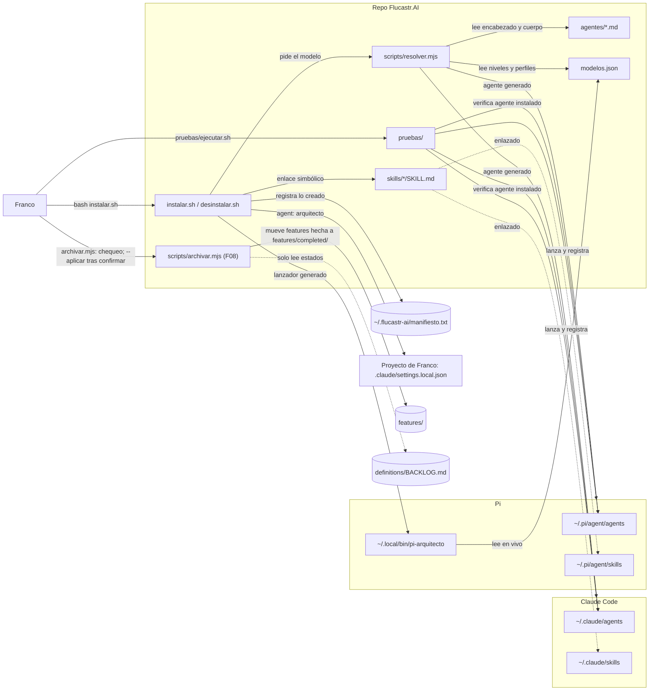
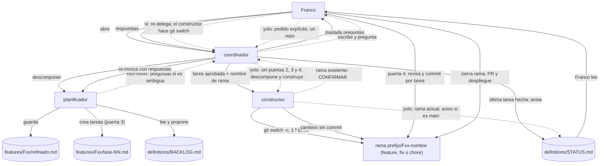
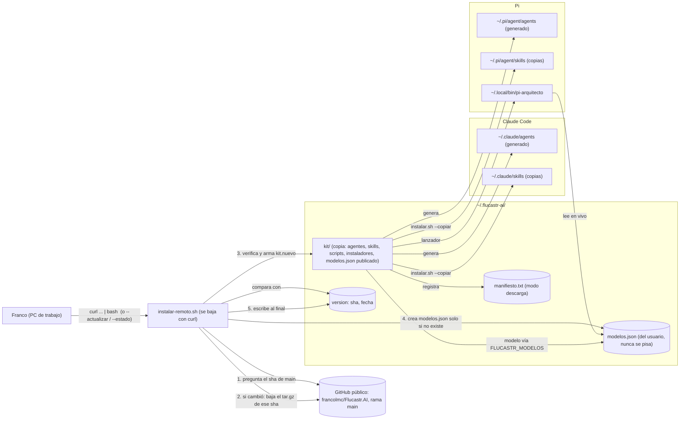
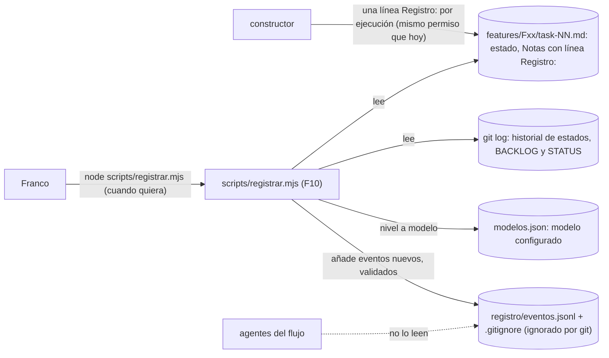
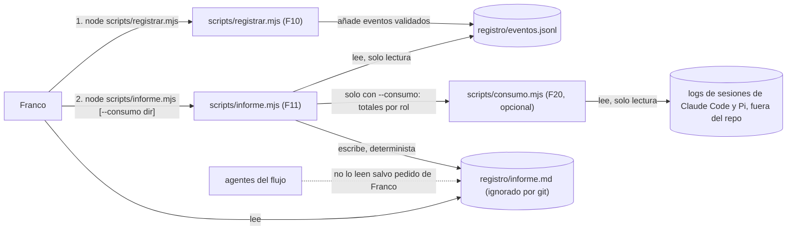

# Arquitectura — Flucastr.AI (modo: actual)

> Estado: **aprobado** (2026-10-29; incluye los cambios de F05 y F06). Puerta 1 de F08 aprobada el 2026-10-30 (`scripts/archivar.mjs`). **Aprobado el 2026-10-30:** `WORKFLOW.md` §3.1 y §10.5 (el `coordinador` corre `registrar.mjs` y `archivar.mjs` solo a pedido explícito de Franco; en Claude Code `tools:` con patrones `Bash(...)` limita y el permiso lo da Franco por aprobación o regla `allow` (ajuste del 2026-10-30); **sin restricción técnica en Pi**, riesgo aceptado por Franco; implementado en F12, 2026-10-30, probado con modelo en ambas herramientas). **Pendiente de aprobación:** **F09, instalación sin clon desde GitHub** (sección «Instalación sin clon…», borrador del 2026-10-30; puerta 1; mergeada) y **F10, registro de eventos del flujo** (sección «Registro de eventos…», borrador del 2026-10-30; puerta 1). **Aprobado el 2026-10-31, puerta 1:** sección «Higiene de contexto» y su línea en `WORKFLOW.md` §3 (queda pendiente de Franco confirmar el proveedor de `openai/gpt-6.1-sol` en el pie de Pi). **Cambio de diseño pendiente de aprobación (borrador del 2026-10-31, puerta 1):** esa sección pasa a «compactación automática instalada por el kit»; ver su subsección «Cambio de diseño». **Aprobado el 2026-10-31, puerta 1:** sección «Skills dentro del workspace para Pi» (F17; queda por verificar en el PC de trabajo lo indicado en «No verificado»).

## Estructura y su razón

Un solo repo, `Flucastr.AI`: configuración, scripts y pruebas. Sin servicio en ejecución, sin base de datos y sin despliegue (confirmado, `REPOS.md`). Se instala en la máquina de Franco; separar repos no tiene razón concreta. *(F09, por aprobar: además puede instalarse sin clon, descargando desde GitHub; sigue siendo un solo repo y un solo árbol de archivos.)*

## Diagrama



## Componentes

| Componente | Responsabilidad | Tecnología | Origen |
|---|---|---|---|
| `agentes/` | Define cada agente. No declara modelo (el resolver rechaza `model:`). | Markdown con encabezado | `agentes/arquitecto.md`, `definicion/plan-pruebas-arquitecto.md` (I6) |
| `skills/` | Procedimientos que el agente carga por paso. | Markdown con encabezado | `skills/*/SKILL.md` |
| `modelos.json` | Fuente única de modelos: niveles, respaldo, perfiles, nivel por agente. | JSON | `modelos.json` |
| `scripts/resolver.mjs` | Resuelve nivel→perfil→modelo y genera los agentes por herramienta. | Node ESM | `README.md`, `definicion/arquitectura.md` |
| `scripts/archivar.mjs` (F08) | Chequeo de contexto de solo lectura; con `--aplicar` mueve a `features/completed/` las features `hecha` con todas sus tareas `hecha`. Ambos modos los corre Franco o, a su pedido explícito, el `coordinador` (Claude Code: `tools:` limita a esos comandos y el permiso lo da Franco, por aprobación o regla `allow`; Pi: `bash` completo, solo la instrucción lo contiene, `WORKFLOW.md` §3.1, aprobado 2026-10-30); sin pedido, el `coordinador` solo deja el comando en `STATUS.md`. Nunca escribe estados ni borra. | Node ESM, sin dependencias | `WORKFLOW.md` §10 |
| `scripts/registrar.mjs` (F10, por aprobar) | Deriva eventos de estados, *Notas* (`Registro:`), `STATUS.md` y `git log` hacia `registro/eventos.jsonl` (solo añadir, idempotente, esquema cerrado sin texto libre). Lo corre Franco o, a su pedido, el `coordinador` (`WORKFLOW.md` §3.1, aprobado); no escribe fuera de `registro/` ni lee `.env`. | Node ESM, sin dependencias; usa `git` | `REGISTRO.md` |
| `instalar.sh` | Valida primero y después enlaza skills, genera agentes y lanzador de Pi, escribe manifiesto. Nunca pisa lo existente. | Bash | `instalar.sh` (cabecera y comentario de validación) |
| `desinstalar.sh` | Quita solo lo del manifiesto; borra generados únicamente si conservan la marca `flucastr-ai:generado`. | Bash | `README.md`, `definicion/arquitectura.md` |
| `pruebas/` | Capa 1 (instalación) y escenarios B, M, R con modelo; fixtures generados, remotos *bare* locales, comprobaciones duras con control negativo, registro estructurado e instantánea. | Bash + Node (`node --test`) | `pruebas/README.md`, `pruebas/ejecutar.sh` |
| Destinos Claude Code / Pi | Donde cada herramienta lee agentes y skills. | Carpetas en `~` | `instalar.sh`; que Pi lea `agents/` sin su paquete de subagentes **no está verificado** |

## Decisiones

| Decisión | Por qué | Descartado y por qué | Qué la cambiaría |
|---|---|---|---|
| Skills **enlazadas**, agentes **generados** (modo desarrollo, con clon) | Skills idénticas en ambas herramientas; el agente necesita el modelo resuelto (inferido); con clon, editar la skill se ve al instante | Copiar todo: no documentado | Que una herramienta no siga enlaces o cambie su formato |
| Skills **copiadas** en el modo descarga (F09, por aprobar) | Sin clon no hay a qué enlazar; Franco lo pidió | Enlaces a `~/.flucastr-ai/kit/` (enlace roto si falla un reemplazo) | Que en el PC de trabajo se quiera editar skills en sitio |
| Dos modos de instalación que no se mezclan (F09, por aprobar) | Una sola fuente de qué hay instalado (`manifiesto` con línea `modo`) | Un solo modo copiando siempre (pierde la edición en vivo en desarrollo) | Que Franco deje de desarrollar con clon |
| Manifiesto + marca de generado | Desinstalar exactamente lo instalado (`README.md`) | No documentado | — |
| Validar antes de actuar | Un `modelos.json` roto dejaba una instalación parcial o destruía la previa (defecto confirmado por la Capa 1 y corregido) | Validar al final | — |
| Pruebas contra el agente **instalado** | Es lo que Franco usa (`plan-pruebas-arquitecto.md`); el ejecutor se detiene si el instalado es el antiguo | Probar los archivos del repo | — |
| Skills bajo demanda | Mantener corto el agente | Todo en el agente | — |
| Archivar con script, bajo confirmación de Franco (F08) | Mantiene corto lo que leen los agentes sin que un agente mueva carpetas ni decida estados | Que el `coordinador` mueva carpetas o corra el script por iniciativa propia (Franco lo descartó el 2026-10-30; el mismo día aprobó permitirlo solo a pedido suyo, limitado por patrones en `tools:` en Claude Code, con permiso de Franco aparte, y con `bash` completo en Pi por su decisión, `WORKFLOW.md` §3.1); mover tareas sueltas (rompe `depende_de:`); segundo archivo de estado para lo archivado (dos fuentes de verdad) | Que el costo de contexto de `features/` siga siendo bajo sin archivar |

## Evolución prevista (no existe hoy)

Tres roles más y un coordinador: `coordinador` (agente principal, delgado), `planificador` (backlog y tareas) y `constructor` (ejecuta una tarea). Franco abre solo el `coordinador`, que invoca a los demás como subagentes y se detiene en cuatro puertas de aprobación. Los roles se traspasan trabajo por archivos: `definitions/` → `definitions/BACKLOG.md` → `features/F01-nombre/task-NN-nombre.md` → `features/completed/`, con `definitions/STATUS.md` para el estado del flujo y los bloqueos. Ningún rol llama a otro: los bloqueos pasan por `STATUS.md`. Detalle en `PROJECT.md`, «Flujo de trabajo». El diagrama de arriba muestra la instalación del kit; el flujo de trabajo se dibuja aparte, en la sección siguiente. El arquitecto deja de ser el agente principal (cambio de una frase en `agentes/arquitecto.md`, de Franco).

## Flujo de trabajo con ramas, refinado y yolo (propuesta, F05 y F06)

Detalle y reglas en `WORKFLOW.md` §9. Es el flujo de los roles sobre archivos, no un componente instalado.



Las flechas punteadas son opcionales: el refinado solo si la feature lo requiere (criterio en `WORKFLOW.md` §9.2); yolo solo a pedido de Franco, sin crear rama (trabaja en la actual, con advertencia en `STATUS.md` si es `main`). El git de escritura de un agente es `git switch -c` del `constructor` en la primera tarea y, si la rama ya existe, `git switch <rama>` solo tras la confirmación de Franco (línea `CONFIRMAR:` vía `coordinador` y `STATUS.md`, `WORKFLOW.md` §9.1); Franco hace los commits, el PR y el despliegue (decidido 2026-10-29).

## Instalación sin clon desde GitHub (propuesta, F09)

> **Cambio por aprobar (puerta 1 de F09).** Decidido por Franco (2026-10-30): el instalador descarga desde `francolmc/Flucastr.AI` y copia a las herramientas; el repo pasa a público (lo hace Franco). *Recomendación mía, por aprobar:* todo lo que sigue sobre rama, versión y actualización. Hoy sigue vigente la instalación desde un clon (sección «Diagrama»): este flujo la **complementa**, no la reemplaza. El PC de trabajo usa solo el modo descarga; el PC de desarrollo (con clon) conserva los enlaces simbólicos, porque ahí se edita y se ve el cambio al instante.

### Diagrama



### Qué se publica y cómo se descarga

- **Qué se publica:** la rama `main` del repo. No hay release ni empaquetado: lo que Franco mergea (PR, puerta 4) es lo que se instala. Para poder fijar una versión, el comando acepta `--ref <rama|tag|sha>` (también sirve de marcha atrás). *Descartado:* releases por etiqueta (un paso manual más, que se olvida y deja versiones viejas sin avisar); `zip` (el `tar.gz` hace lo mismo y `tar` ya está donde hay `bash`). *Lo cambiaría:* que `main` reciba trabajo a medias, o que Franco quiera decidir cuándo llega algo al PC de trabajo; entonces se pasa a etiquetas.
- **Orden de la descarga (sin `git`, con `curl` y `tar`):** (1) `GET api.github.com/repos/francolmc/Flucastr.AI/commits/main` con `Accept: application/vnd.github.sha` devuelve el sha de 40 caracteres; (2) `GET codeload.github.com/francolmc/Flucastr.AI/tar.gz/<sha>`. Se descarga **el sha fijado en el paso 1**, no `main`, para no mezclar versiones si alguien publica entre las dos llamadas. API sin autenticar: 60 consultas/hora por IP (suficiente; si la red corporativa comparte IP y falla, el script lo dice y ofrece `--ref <sha>`).
- **Verificación mínima de integridad** (*recomendación*; los `tar.gz` de GitHub no tienen un hash publicado que comparar, así que **no hay autenticidad más allá de HTTPS y de la cuenta de GitHub**): HTTPS; `curl --fail` con tope de tiempo y de tamaño; el sha recibido coincide con `^[0-9a-f]{40}$`; antes de extraer se lista el archivo (`tar -tzf`) y se rechaza cualquier ruta absoluta o con `..`, o cualquier enlace simbólico; se extrae solo a una carpeta temporal nueva y vacía en `~/.flucastr-ai/tmp/`; se exigen `instalar.sh`, `modelos.json`, `agentes/*.md` y `skills/*/SKILL.md`; se aceptan solo estas rutas (lista permitida): `agentes/`, `skills/`, `scripts/`, `instalar.sh`, `desinstalar.sh`, `instalar-remoto.sh`, `modelos.json`. No se copian `pruebas/`, `definitions/`, `features/` ni `README.md`. Antes de tocar nada se valida con el `resolver` el `modelos.json` **del usuario** contra los agentes nuevos (misma regla que hoy: «validar antes de actuar»).
- **Riesgo asumido de `curl | bash`:** quien controle la cuenta de GitHub controla lo que se ejecuta en el PC de trabajo. Mitigación: 2FA en la cuenta, protección de `main` (PR obligatorio) y la forma alternativa de dos pasos (bajar `instalar-remoto.sh`, leerlo y correrlo), que la documentación ofrece primero.

### Cómo se copian agentes y skills sin enlaces simbólicos

- **Un solo lugar permanente, `~/.flucastr-ai/kit/`:** es la copia descargada y hace de «raíz» para los scripts (`RAIZ` en `instalar.sh`). Sin él, el lanzador de Pi (que lee `agentes/` y `scripts/resolver.mjs` en vivo) y `desinstalar.sh` no tendrían de dónde leer. Se descartó generar un lanzador que lleve el cuerpo del agente incrustado: obligaría a reinstalar para cada cambio y duplica lógica.
- **Skills:** `instalar.sh --copiar` hace `cp -R` de cada `skills/<n>/` a `~/.claude/skills/<n>/` y `~/.pi/agent/skills/<n>/`, y deja dentro un archivo vacío `.flucastr-ai` como marca. Mismas reglas de hoy: nunca pisa lo ajeno (si el destino existe y no tiene la marca, `OMITIDO`) y registra cada carpeta en el manifiesto con tipo nuevo `directorio`.
- **Agentes y lanzador:** igual que hoy (los genera el `resolver`, con la marca `flucastr-ai:generado`); el lanzador queda apuntando a `~/.flucastr-ai/kit`.
- **Manifiesto:** gana una línea `modo<TAB>descarga` (el modo desarrollo escribe `modo<TAB>repo`). `instalar.sh` se niega a cambiar de modo sobre una instalación del otro modo, con el mensaje de desinstalar primero (mezclar dejaría enlaces a un clon que `desinstalar.sh` del kit no reconoce).
- **Desinstalar:** `desinstalar.sh` quita las carpetas con marca, los agentes generados, el lanzador, `kit/`, `version` y el manifiesto; **conserva `~/.flucastr-ai/modelos.json`** salvo `--todo`.
- *Descartado:* mantener enlaces apuntando a `kit/` (Franco pidió copiar; además un enlace roto tras un `kit/` a medio reemplazar deja las herramientas sin skills).

### `modelos.json` local del usuario

- **Dónde:** `~/.flucastr-ai/modelos.json`, fuera de `kit/`, así que reemplazar `kit/` nunca lo toca. En la primera instalación se crea copiando el publicado; después **jamás se sobrescribe ni se edita**.
- **Cómo lo lee el código:** `scripts/resolver.mjs` usa la variable `FLUCASTR_MODELOS` si existe y, si no, `modelos.json` junto al repo (el modo desarrollo y todas las pruebas actuales no cambian). `instalar.sh --copiar` la fija al validar y generar; el lanzador de Pi la lleva escrita. Sin lectura implícita de `~`, para que ninguna prueba dependa del HOME.
- **Al actualizar:** si el `modelos.json` publicado tiene un `version` mayor que el del usuario, o define agentes/perfiles que el del usuario no tiene, el instalador **avisa** y deja el publicado en `kit/modelos.json` para comparar; no mezcla. Un agente nuevo sin entrada cae en `nivel_por_defecto` (comportamiento actual del `resolver`), y el perfil faltante se informa porque `resolver` ya falla con mensaje claro.
- *Descartado:* fusión automática (decide por Franco qué modelo usar); guardar sus cambios como parche (frágil).

### Versión instalada y publicada

- **Instalada:** `~/.flucastr-ai/version` (texto: `sha`, `fecha` de instalación, `ref`). Se escribe **al final**, solo si todo salió bien: si falla a la mitad, el archivo conserva la versión anterior.
- **Publicada:** el sha de `main` (paso 1 de la descarga). *Descartado:* un archivo `VERSION` a mano (se olvida subirlo y no avisa); comparar fechas (frágil).
- **Comandos** (todos manuales; **sin procesos en segundo plano, cron ni aviso automático**): `--estado` (una llamada a la API, no descarga: «instalada X, publicada Y»); `--actualizar` o volver a correr el mismo comando (compara; si coincide, «al día» y termina; si no, descarga e instala); `--ref <…>` para fijar versión. *Supuesto a confirmar con Franco* (recomendación mía que aceptó implícitamente): que baste con ejecutarlo a mano cuando se entere de un cambio.
- **Actualización atómica:** se arma `kit.nuevo/`, se valida, se renombra `kit/`→`kit.anterior/` y `kit.nuevo/`→`kit/`, se corre `instalar.sh --copiar`; si algo falla se vuelve a `kit.anterior/` y se reinstala desde ahí. `kit.anterior/` se borra al terminar bien.

### Supuestos sobre el PC de trabajo (a confirmar)

Sistema operativo con `bash`, `curl`, `tar` y `node` (macOS o Linux); acceso HTTPS a `raw.githubusercontent.com`, `api.github.com` y `codeload.github.com`; Claude Code y/o Pi ya instalados. Si el PC es Windows, o la red filtra GitHub, este diseño no sirve tal cual (preguntas 1 y 2 de Franco).

## Registro de eventos del flujo (propuesta, F10)

> **Cambio por aprobar (puerta 1 de F10).** Diseño completo, esquema, privacidad y pruebas en [`REGISTRO.md`](REGISTRO.md). Es un índice **derivado y reproducible**: la fuente de verdad sigue siendo `BACKLOG.md`, las tareas y git.



- **Decisión:** un solo escritor, `registrar.mjs`, que corre Franco o, a su pedido explícito, el `coordinador` (`WORKFLOW.md` §3.1, F12, 2026-10-30). Los agentes no reciben permisos nuevos; el único cambio es el contenido de *Notas*. *Descartado:* agentes que escriben el log; versionar el log (ver `REGISTRO.md` §2 y §8).
- **Privacidad:** esquema cerrado, sin texto libre, sin autores ni títulos; archivo ignorado por git (`REGISTRO.md` §5).
- **Fuera de lo que `instalar-remoto.sh` distribuye:** `registro/` no está en su lista permitida; `scripts/registrar.mjs` sí viaja con `scripts/`.

## Skills dentro del workspace para Pi (F17)

> **Puerta 1 aprobada por Franco el 2026-10-31** (sus 4 decisiones, abajo). Problema (*confirmado por Franco*): en el PC de trabajo, `pi-arquitecto` no puede leer fuera del workspace y queda pidiendo `definir-proyecto` y `disenar-arquitectura` «dentro del workspace»; hoy las skills viven en `~/.pi/agent/skills/`. No hay código aún. No toca `WORKFLOW.md`.

### Evidencia sobre Pi (leída en el equipo, Pi 1.4.0)

- **Confirmado** (`docs/configuration.md` y `docs/security.md` del paquete `pi-coding-agent`, en `~/.pi/agent/install/releases/1.4.0/`): `.pi/skills/` es una ruta de **skills de proyecto**, y Pi las descubre recursivamente (`docs/skills.md`). También acepta `.agents/skills/` (del directorio de trabajo hacia arriba, hasta la raíz del repo).
- **Confirmado, y es una condición:** `.pi/skills/` está protegida por la **confianza de proyecto**. Pi pregunta una vez (`/trust` la guarda en `~/.pi/agent/trust.json`); en modo sin pantalla (print, JSON, RPC) las omite salvo `defaultProjectTrust: "always"`. Un `.pi/` vacío no pide confianza, pero con skills dentro sí.
- **No verificado:** (a) que el bloqueo de Franco desaparezca con esta ruta: no reproduje su PC ni encontré en la documentación local una restricción de lectura «fuera del workspace»; el límite puede venir de su configuración, de una extensión o de la política del PC; (b) si Pi sigue enlaces simbólicos en `.pi/skills/` (la documentación no lo dice; irrelevante porque se copia). Se comprueba en el PC de trabajo, antes de dar la feature por buena.

### Qué se propone

- **Dónde:** `<proyecto>/.pi/skills/<skill>/`, una carpeta real por cada skill de `skills/*/` (las siete son autocontenidas: solo `SKILL.md`, sin rutas fuera de su carpeta; *confirmado*). Cada copia lleva la marca `.flucastr-ai`, como en el modo descarga. *Descartado:* `.agents/skills/` (lo leen también otras herramientas y se busca en ancestros: más alcance del necesario).
- **Flag (recomendación):** uno nuevo, **`--skills-proyecto`**, que se combina con `--proyecto <ruta>`; solo copia las skills a Pi, no cambia el agente de Claude Code. Sin `--proyecto` es error. *Descartado:* extender `--solo pi` con `--proyecto`: hoy `--solo pi` significa «solo la instalación global de Pi» y `--proyecto` «ajuste de Claude Code»; combinarlos cambiaría el significado de ambos y el efecto sobre el proyecto quedaría implícito.
- **Siempre copia, nunca enlace**, en modo repo y en modo descarga: un enlace apunta fuera del workspace, justo lo que falla. Reutiliza `copiar_skills` apuntando a `<proyecto>/.pi/skills`. Nunca pisa una carpeta del cliente sin la marca (`OMITIDO`, como hoy).
- **Que no entren al git del cliente:** una línea por skill copiada (`/.pi/skills/<skill>/`) en `<proyecto>/.git/info/exclude`, la exclusión **local** de git (no se versiona ni cambia el `.gitignore` del cliente). Rutas por skill, no `/.pi/`, para no ocultar skills propias del cliente. Se resuelve con `git -C <proyecto> rev-parse --git-path info/exclude`; si no es repo git, se copia igual y avisa que no hay nada que excluir. Las líneas llevan el comentario `# flucastr-ai` y solo se quitan esas. Verificación: `git status --porcelain` del proyecto no muestra las copias.
- **Registro en el manifiesto** (formato `tipo<TAB>ruta<TAB>extra`): `skills-proyecto<TAB><proyecto>` (una por proyecto, se conserva al reinstalar, como `ajuste`); `directorio<TAB><proyecto>/.pi/skills/<skill>` por copia (tipo existente: `desinstalar.sh` ya exige carpeta real con marca); `exclusion<TAB><archivo exclude><TAB><línea>` (tipo nuevo, quita solo esa línea).
- **Actualizar:** al correr `instalar.sh` (o `instalar-remoto.sh --actualizar`, que lo invoca) se rehace la copia en cada proyecto registrado, tras quitar la anterior; así las skills del cliente nunca quedan viejas respecto del kit. Si la carpeta del proyecto ya no existe, se omite con aviso y se conserva el registro. No hay actualización automática ni en segundo plano.
- **Desinstalar:** `desinstalar.sh --proyecto <ruta>` quita, además del agente, las copias y las líneas de exclusión de ese proyecto; `desinstalar.sh` sin opciones quita todo lo registrado. Borra solo carpetas con marca; si el usuario editó dentro de una copia, se pierde: las copias no se editan (se dice en la salida).
- **`--simular`:** imprime lo que copiaría y excluiría, sin escribir. Valida antes de actuar (proyecto existente, skills presentes) como el resto.
- **Pruebas (Capa 1, sin red ni modelo):** `HOME` falso y proyecto de prueba con `git init` local; comprobar copias reales con marca, exclusión en `.git/info/exclude`, `git status` limpio, reinstalación idempotente, proyecto sin git, carpeta ajena sin marca intacta, desinstalar con `--proyecto` y total, y un control negativo (sin el flag no aparece `.pi/`). No cambia el flujo sin clon ya aprobado: `instalar-remoto.sh` solo hereda el flag al reinstalar proyectos registrados.

### Riesgos

- Las copias en el proyecto quedan **fuera de git** y pueden desfasarse hasta la siguiente corrida del instalador.
- El cliente ve `.pi/skills/` en su disco (no en git). Contenido: solo texto de las skills del kit.
- La confianza de proyecto es una decisión de Franco dentro de Pi; el instalador no la toca (no escribe `trust.json`).

### Decisiones tomadas por Franco (2026-10-31)

1. **Nombre del flag.** **Decidido:** `--skills-proyecto` (explícito, aparte de `--proyecto`). Descartada: `--proyecto <ruta> --solo pi`.
2. **Ruta.** **Decidido:** `.pi/skills/` (documentada y específica de Pi). Descartada: `.agents/skills/`.
3. **¿Siempre al usar `--proyecto`, o solo con el flag?** **Decidido:** solo con el flag: `--proyecto` hoy solo toca Claude Code y no escribe nada nuevo en el cliente sin pedirlo.
4. **Exclusión local** (`.git/info/exclude`) en vez de `.gitignore` del cliente. **Decidido.**

## Higiene de contexto (aprobado 2026-10-31; cambio de diseño APROBADO el 2026-10-31, puerta 1)

### Consumo del `coordinador` (medido 2026-10-31)

El costo está en las sesiones largas que releen su contexto, sobre todo el `coordinador`; la mitigación (lectura por rol, topes de tamaño y medición) está en [`CONTEXTO.md`](CONTEXTO.md). `compactar_en` por perfil se decide en F25. No cambia el diseño de compactación ya aprobado.

### Cambio de diseño (APROBADO el 2026-10-31, puerta 1)

**Aprobación (Franco, 2026-10-31, puerta 1; informe `pruebas/resultados/2026-10-31-verificacion-compactacion.md`).** (1) Ajuste global de Pi (`~/.pi/agent/settings.json`, `compaction.modelOverrides`) y, en Claude Code, `.claude/settings.local.json` de los proyectos instalados con `--proyecto`. (2) `compactar_en` = 100000, editable en `modelos.json` (Claude Code lleva +33000). (3) Se elimina `CONTEXTO:`. (4) Se descarta la extensión de Pi con `ctx.compact()`. (5) Línea de identidad «Herramienta | Modelo | Agente» como primera línea del cuerpo de cada agente generado. Implementación en dos features: F18 (identidad, quitar la referencia a `modelos.json` de los prompts, lectura acotada) y F19 (compactación automática instalada por el kit). Las preguntas de «5. Preguntas abiertas» quedan respondidas por estas decisiones.

**Tras instalar, Franco debe comprobar:** abrir Pi nuevo o ejecutar `/reload` (Pi no relee `settings.json` en caliente) y hacer `diff` de `~/.pi/agent/settings.json` contra su copia previa: solo debe aparecer `compaction.modelOverrides` para los modelos del kit; el resto, intacto.

**Motivo.** Franco trabaja a menudo desde el celular: no quiere aplicar la configuración a mano ni depender de teclear `/new` o `/compact`. Prefiere que el kit la deje puesta y que el agente la gestione.

**Qué cambia respecto de lo aprobado hoy** (lo no listado queda igual):

| Tema | Aprobado hoy | Aprobado (2026-10-31) |
|---|---|---|
| Compactación por proyecto | Guía en el README; **no** se instala | **La instala `instalar.sh`** (Pi, ajuste global; ver abajo) |
| `CONTEXTO: sesion-nueva \| compactar` en puertas y pausas | Obligatoria | **Se elimina** (opción B: queda opcional; ver pregunta 3). La compactación automática la hace la herramienta; yolo ya no necesita `compactar` porque la sesión sigue |
| «Fuera de alcance: instalar `.pi/settings.json`» | Fuera | **Dentro**, pero en el ajuste global de Pi, no en el proyecto |
| `modelos.json` | Sin ventanas | Campos nuevos `ventanas` (por perfil) y `compactar_en` |
| Claude Code | Solo guía | **La instala `instalar.sh`** en `<proyecto>/.claude/settings.local.json` (`autoCompactWindow`, ya verificado el 2026-10-31; ver «Verificado») |

**1. ¿Puede un agente o extensión disparar `/compact` o abrir sesión nueva?**

- Pi, CONFIRMADO: una extensión **puede compactar**: `ctx.compact(options?)` («Trigger compaction without awaiting completion», en `ExtensionContext`, disponible en todos los contextos) y los manejadores de `turn_end`/`agent_before_settle` pueden proponer una entrada `compaction` (`~/.pi/agent/install/releases/1.4.0/node_modules/@earendil-works/pi-coding-agent/dist/core/extensions/types.d.ts` líneas ~249 y ~1671; `docs/extensions.md` líneas 230 y 326). `ctx.getContextUsage()` permite medir.
- Pi, CONFIRMADO: **sesión nueva solo desde comandos de extensión** (`ExtensionCommandContext.newSession()`, `types.d.ts` ~292); `docs/extensions.md` línea 330 dice que esas operaciones son «command-only» porque desde manejadores de ciclo de vida pueden bloquear el runtime. Un **modelo** no tiene herramienta propia para ninguna de las dos cosas: ninguna herramienta integrada lo hace, y `pi-subagents` 0.84.0 tampoco (CONFIRMADO el 2026-10-31: registra solo las herramientas `subagent`, `contact_supervisor`, `structured_output`, `bg_wait` y `watchdog_*`, y comandos `/subagents…`/`/run`; ninguna llama a `compact` ni a `newSession`; `pi-agent-mode` 1.3.0 y `pi-notify` 1.4.0 tampoco).
- Claude Code 2.1.308, CONFIRMADO en el binario (cadenas, no documentación ni prueba): existen `/compact`, `/clear`, `/autocompact` y el evento de hook `PreCompact` (40 apariciones). Resuelto el 2026-10-31 (binario 2.1.308 y prueba): `PreCompact` **solo reacciona** (descripción del propio hook: exit 0 añade instrucciones de resumen, exit 2 **bloquea** la compactación); no inicia nada. `/compact` es un comando local con `supportsNonInteractive: true`: **un proceso externo** sí lo puede lanzar (`claude -p -c "/compact"` compactó la sesión, evento `compact_boundary` con `trigger: manual`), pero **no hay herramienta del modelo** que lo haga. Conclusión: un agente o hook **no puede** disparar compactación ni sesión nueva en Claude Code.
- Conclusión: el diseño **no depende** de que el agente dispare nada. Usa la compactación automática de la herramienta (umbral) que ya existe en ambas. Una extensión de Pi que llame `ctx.compact()` en cada puerta es posible pero es código nuevo, un artefacto más que instalar y no aporta sobre el umbral: queda **descartada por ahora** (se reevalúa solo si el umbral demuestra compactar tarde).

**2. Qué deja puesto el instalador**

*Pi (diseñable hoy).* `instalar.sh` escribe, en `~/.pi/agent/settings.json` (ajuste **global**), solo esto por cada modelo de Pi que resuelva `modelos.json` y que declare ventana:

```json
{ "compaction": { "modelOverrides": { "openai/gpt-6.1-sol": { "reserveTokens": 172000 } } } }
```

- *Por qué global y no por proyecto.* CONFIRMADO (`docs/settings.md` líneas 69-80; `docs/configuration.md` línea 3): `compaction.modelOverrides` se indexa por `provider/modelId` exacto, así que el ajuste global **solo afecta a los modelos del kit**; el global no exige `/trust`; el de proyecto sí y se ignora hasta confiar. Para Franco (celular, `--proyecto` y varios proyectos) el global funciona en todos de una vez y no escribe nada en el repo del cliente: no hay `.pi/settings.json` que excluir de git. Costo: también compacta a ≈100 k cuando Franco usa esos modelos fuera del kit (se avisa en la salida). El ajuste de **proyecto** (`<proyecto>/.pi/settings.json`) queda descartado para el instalador; si algún día se quisiera, iría por `--proyecto` con exclusión en `.git/info/exclude` (mecanismo ya existente de F17, `exclusion`) y `/trust` manual de Franco.
- *Forma exacta y validación (CONFIRMADO en `core/settings-manager.js` y `core/settings-schema.js` de Pi 1.4.0 y por prueba).* `compaction` admite `enabled` (booleano), `reserveTokens` y `keepRecentTokens` (enteros seguros no negativos) y `modelOverrides` (objeto `"provider/modelId"` → `{reserveTokens?, keepRecentTokens?}`); la clave es exacta y distingue mayúsculas. Un valor inválido en el override del modelo activo **falla al leer** (`Invalid compaction.modelOverrides["openai/gpt-6-luna"].reserveTokens setting: abc. Expected a non-negative safe integer.`); las claves desconocidas se **toleran y se conservan**; un JSON roto produce `Warning: Invalid settings file …` y se **ignora** el archivo (Pi sigue). Se aplica en ajuste global y de proyecto (se fusionan antes de buscar el modelo).
- *Fusión sin pisar.* Se lee el JSON; si no es válido, no se toca (como `leerAjustes` en `scripts/resolver.mjs`). Se escribe `compaction.modelOverrides[modelo].reserveTokens` **solo si** ese campo no existe. Si Franco ya definió `compaction.enabled`, `compaction.reserveTokens` en el nivel superior o cualquier `modelOverrides` para ese modelo, **se respeta** y se imprime `OMITIDO (ya define compaction...)`, igual que con el agente predeterminado. Las demás claves (`packages`, `deviceId`, etc.) quedan tal cual. Escritura atómica (archivo temporal y renombrar) porque Pi también reescribe ese archivo. CONFIRMADO cómo escribe Pi: toma un bloqueo `proper-lockfile` (`mkdir` de `<settings.json>.lock`, 10 reintentos de 20 ms), **relee el archivo bajo el bloqueo**, cambia solo los campos que él modificó (`enabled`, etc.) y escribe con `writeFileSync` (sin renombrar; reformatea a 2 espacios). Prueba aislada: una clave que otro proceso añadió *después* de que Pi cargó **se conserva** en su escritura siguiente. No relee en caliente: lee al arrancar y con `/reload` (un Pi ya abierto aplica el cambio al reiniciar). El kit debe, entonces, tomar el mismo bloqueo (`mkdir <settings.json>.lock`, soltarlo con `rmdir`, reintentos cortos) además de escribir con temporal y renombrar. Orden nuevo en `resolver.mjs`: `fijar-compactacion <settings.json> <modelo> <reserve>` y `quitar-compactacion <settings.json> <modelo> <reserve>` (salidas `fijado`, `ya-estaba`, `omitido:<motivo>`; `quitado`, `omitido`, `archivo-quitado`), simétricas a `fijar-agente`/`quitar-agente`.
- *Manifiesto y desinstalación.* Línea nueva `compactacion<TAB><settings.json><TAB><modelo>=<reserve>`. `desinstalar.sh` llama `quitar-compactacion`, que borra la clave **solo si su valor sigue siendo el que puso el kit** y poda `modelOverrides`/`compaction` solo si quedan vacíos; nunca borra un `settings.json` que ya existía. A diferencia de `ajuste` (por proyecto, se conserva al reinstalar), esta se **rehace en cada instalación** (se quita y se vuelve a poner con los valores actuales de `modelos.json`). `--simular` imprime lo que escribiría.
- *Valores sin hardcodear.* En `modelos.json`, por perfil, `ventanas` (ventana de contexto en tokens por `provider/modelId`) y, arriba, `compactar_en` (umbral deseado, defecto propuesto 100000; un perfil puede sobreescribirlo). Cálculo en `resolver.mjs`: `reserveTokens = ventana − compactar_en`. Ejemplo: `"ventanas": { "openai/gpt-6-astra": 272000, "openai/gpt-6.1-sol": 272000, "openai/gpt-6-luna": 272000 }` y `compactar_en: 100000` dan `172000` para cada uno (coincide con el sondeo). Las tres ventanas están CONFIRMADAS el 2026-10-31 en el catálogo de Pi (`pi-ai/dist/providers/data/openai.json`, entradas `chat:`; y `pi --list-models gpt-6`): proveedor `openai`, `openai/gpt-6-astra` = 272000, `openai/gpt-6.1-sol` = 272000, `openai/gpt-6-luna` = 272000 (todas 272K; `maxTokens` 128000). Ojo: el mismo archivo trae `classifier:gpt-6-luna` con 922000 (API `openai-decisions`, no es el modelo de chat) y el proveedor `openai-codex` declara `gpt-6.1-sol` en 500000; la clave del override usa el proveedor del perfil (`openai`), así que no aplica. Se declaran las tres.
- *Modelo sin ventana, o umbral inaplicable.* Si falta `ventanas[modelo]` o `compactar_en`, o si `ventana − compactar_en` < 16384 (peor que el defecto de Pi), ese modelo se **omite con aviso** y Pi usa su valor por defecto (compacta cerca del límite); el flujo funciona igual. Un `modelos.json` personal antiguo (sin los campos) simplemente no instala nada; `comparar-modelos` avisa de «campo nuevo: compactar_en/ventanas».

*Claude Code (verificado el 2026-10-31; informe `pruebas/resultados/2026-10-31-verificacion-compactacion.md`).* CONFIRMADO con `claude -p "/context"` (sin costo de modelo) y con una compactación real:

- *Claves.* `autoCompactWindow` (número, global) y `modelSettings.<modelo canónico>.autoCompactWindow` (número o `"auto"`; p. ej. `claude-haiku-5-5`). Variable `CLAUDE_CODE_AUTO_COMPACT_WINDOW`.
- *Archivos y precedencia (de menor a mayor).* `~/.claude/settings.json` < `<proyecto>/.claude/settings.json` < `<proyecto>/.claude/settings.local.json` < `--settings` < variable de entorno. El campo `autoCompactWindow:` del frontmatter de un agente **no** afecta a la sesión principal (`claude --agent …`): solo vale como tope para ese agente cuando corre como subagente (código: «Overrides the window it would inherit»; la sesión principal midió 230k con el agente en 111k y en 300k).
- *Rango.* 100000 a 1000000. En ajustes, un valor fuera de rango (50000, 2000000) o no numérico se **ignora en silencio** (la ventana vuelve al valor del modelo, 1m en estos modelos); en la variable de entorno, un valor bajo se **sube a 100000** y uno no numérico se ignora con aviso. JSON roto: `Invalid or malformed JSON` y se ignora el archivo. Claves desconocidas: se toleran.
- *Dentro de un mismo archivo,* el valor por modelo reemplaza al global para ese modelo; entre archivos, un `autoCompactWindow` global en un archivo de mayor precedencia descarta los valores por modelo de los de menor, y un valor por modelo de mayor precedencia gana para ese modelo.
- *Umbral real = ventana − 33000.* `/context` muestra `Autocompact buffer 33k` (igual en haiku, sonnet y opus). Prueba real: con `autoCompactWindow: 100000` la sesión se compactó sola (`trigger: auto`) con `pre_tokens: 74082` (el contexto estaba en ≈55 k al empezar el turno anterior, sin compactar, y en 74 k al compactar: el disparo ocurrió antes de los 100 k de la ventana, consistente con 100 k − 33 k = 67 k). Por eso, para compactar al llegar a `compactar_en` tokens de contexto, el valor a escribir es **`compactar_en + 33000`** (100000 → 133000), constante en `resolver.mjs` con este comentario; con 100000 compactaría a ≈67k. Mínimo alcanzable: ≈67k.
- *Dónde.* `<proyecto>/.claude/settings.local.json` (el mismo que usa `fijar-agente`, personal, fuera de git por convención de la herramienta) con `fijar-compactacion` y la misma regla de no pisar. Se prefiere esto a `~/.claude/settings.json`, que no se toca (lo escribe Claude Code y tiene `modelSettings`).

**3. La regla neutral.** Con compactación automática el estado ya no depende de que Franco cierre sesión. `WORKFLOW.md` §3 pasa de «`CONTEXTO:` en cada puerta» a una frase corta: el estado vive en `STATUS.md` y archivos; el kit deja puesta la compactación automática (`instalar.sh`). Se elimina la línea fija y su prueba (la prueba sin modelo pasa a comprobar que `modelos.json` produce el `reserveTokens` esperado y que instalar/desinstalar es simétrico). En yolo, compactar en la misma sesión **no** pierde la vigencia de yolo (§9.3), lo que resolvía `CONTEXTO: compactar`. `WORKFLOW.md` mide 30.680 caracteres (umbral 30.720): la viñeta borrador es casi igual de larga por llevar la marca de borrador; al aprobar, quitar la marca la deja ≈100 caracteres más corta.

**4. Riesgos.**

- *Compactar pierde detalle.* INFERIDO, a verificar con modelo: el estado del flujo está en `STATUS.md`, `BACKLOG.md` y `features/`, no en la conversación, y Pi conserva los últimos 20 k tokens (`keepRecentTokens`) y un resumen estructurado (`docs/compaction.md`). Pierde: razonamiento intermedio, salidas de subagentes que el `coordinador` no haya anotado, una pregunta a Franco a medias. Mitigación: el `coordinador` ya escribe «Espera a Franco» y el paso actual en `STATUS.md` antes de pausar; la prueba con modelo de F18 incluye una corrida que cruce una compactación (con `reserveTokens` bajo de prueba) y compruebe que retoma desde `STATUS.md`. Pi puede compactar entre turnos de una misma corrida (`docs/compaction.md`), así que no hay punto «seguro»: por eso el estado se escribe antes de delegar, no al final.
- *Tocar archivos del usuario.* `~/.pi/agent/settings.json` es del usuario y Pi lo reescribe. Mitigación: solo si es JSON válido, solo claves nuevas, escritura atómica, registro y desinstalación exactos, `--simular`, y aviso si el usuario ya tenía `compaction`.
- *Proyectos del cliente.* El diseño global no crea nada en el repo del cliente. Si se usara el ajuste de proyecto de Claude Code, es `.claude/settings.local.json`, personal por convención de la herramienta; aun así se debe verificar que no se versiona y, si hiciera falta, excluirlo en `.git/info/exclude` como las skills.
- *Efecto fuera del kit.* El mismo modelo en uso personal también compacta a ≈100 k. Reversible con `desinstalar.sh` o editando el valor (si Franco lo cambia, el kit lo respeta como suyo).
- *Fórmula con el proveedor equivocado.* Si `openai/gpt-6.1-sol` fuera `openai-codex` (500 k), `172000` compactaría a ≈328 k: no rompe nada, solo no ahorra. Resuelto: el perfil `pi-openai` declara proveedor `openai` (272 k, catálogo y pie de Pi); `openai-codex` no se usa.

**5. Preguntas abiertas para Franco (con recomendación).**

1. ¿Ajuste **global** de Pi en vez de por proyecto? *Recomiendo global* (celular, sin `/trust`, nada en repos del cliente); costo: también aplica fuera del kit.
2. ¿Umbral `compactar_en` = 100000 como defecto, editable en `modelos.json`? *Recomiendo sí* (punto de partida del sondeo, a medir con `showCacheMissNotices`).
3. ¿Elimino `CONTEXTO:` del todo (A) o lo dejo como línea opcional de una sola forma `CONTEXTO: sesion-nueva` (B)? *Recomiendo A*: Franco no quiere teclear comandos y no hay nada que sugerir que el kit no haga solo; si se prefiere B, no es obligatoria ni probada.
4. Claude Code: **resuelta por la verificación** (ya no se espera): se instala `autoCompactWindow = compactar_en + 33000` en `.claude/settings.local.json` (ver arriba). Solo queda tu visto bueno del valor por defecto (pregunta 2).
5. ¿Descartar la extensión de Pi con `ctx.compact()`? *Recomiendo descartar por ahora*; reevaluar si el umbral compacta tarde. (Dato nuevo: `pi-subagents` no aporta ninguna herramienta de compactar; en Claude Code tampoco existe.)
6. **Resuelta por la verificación:** se declaran las tres ventanas (`gpt-6-astra`, `gpt-6.1-sol`, `gpt-6-luna`, 272000 cada una; ya no se omite ninguna).

**Qué se revisó en la puerta 1 (aprobado).** (a) La tabla «Qué cambia». (b) Global frente a proyecto (pregunta 1). (c) Eliminar `CONTEXTO:` (pregunta 3), que cambia el alcance ya decidido de F18 (puntos 1, 3 y «Fuera» del `BACKLOG.md`: el coordinador lo reescribirá al aprobar). (d) Que el riesgo de compactar durante una corrida es aceptable con la mitigación indicada.

**6. Identidad del agente en ejecución (requisito nuevo de Franco, 2026-10-31).** Para que el agente sepa en qué herramienta corre, con qué modelo y como qué agente, `resolver.mjs` (órdenes `agente-claude` y `agente-pi`, que ya conocen herramienta, modelo y nombre) escribe, como **primera línea del cuerpo** (justo después del `---` de cierre del encabezado), una línea fija distinta por herramienta:

```
Herramienta: Pi | Modelo: openai/gpt-6.1-sol | Agente: coordinador
Herramienta: Claude Code | Modelo: claude-sonnet-5-5 | Agente: coordinador
```

Probado en una copia aislada del repo (el repo no se tocó): la salida queda correcta; **no rompe** ningún comprobador de contrato (`contrato-roles`, `agente-instalado`, `modelos-agentes` y la Capa 1 leen el archivo fuente de `agentes/` o solo el encabezado), pero **dos pruebas de `resolver-agentes.test.mjs` ((3) y (6)) comparan la salida de Pi con la de Claude Code «salvo `model:`»** y fallan porque la línea difiere por herramienta; se corrige añadiendo `Herramienta:` al filtro de su ayudante `sinLineaModelo` (con eso la copia vuelve al resultado del control). Esas dos pruebas son parte de la tarea. Límites: la línea fija el modelo **al instalar** (si Franco lanza con otro `--model`, la línea queda desactualizada); en Pi, además, el agente puede leer el modelo real con `echo "$PI_PROVIDER/$PI_MODEL"` (variables que Pi documenta para sus herramientas de shell, `docs/environment-variables.md`); en Claude Code el modelo real ya figura en su contexto de sistema.

**SUSTITUIDO parcialmente por el cambio aprobado arriba (2026-10-31, puerta 1). El texto que sigue se mantiene solo por trazabilidad; donde contradiga el cuadro de arriba (en particular `CONTEXTO:` y «Fuera de alcance: instalar `.pi/settings.json`») ya no rige.**

> Base: `pruebas/resultados/2026-10-31-sondeo-consumo-pi.md` (Pi) y `2026-10-31-sondeo-codex.md` (Codex). Este bloque separa **regla** (neutral y estable, vive en `WORKFLOW.md` §3) de **mecanismo** (cambia por herramienta, vive aquí). Nada de esto toca código, agentes ni skills todavía; la implementación sería una feature aparte (F18).

### La regla (neutral)

- **Qué.** El estado del flujo vive en `STATUS.md` y en los archivos, no en la conversación. Por eso, en cada puerta o pausa, Franco puede cerrar la sesión y abrir otra (o compactar) sin perder nada. Más contexto reenviado por turno es más costo y más deriva (Pi, *inferido*: ≈2,4 veces más por turno a 130 k que a 25 k de contexto; sesión nueva por puerta ≈ −55 %).
- **Quién y cuándo.** El `coordinador`, en cada puerta y en cada pausa de pregunta (`CONFIRMAR:`, `REFINAR:`), sin bloquear.
- ~~SUSTITUIDO (se elimina `CONTEXTO:`, puerta 1 2026-10-31)~~ **Frase fija (comprobable).** Última línea de «Espera a Franco» **y** de su respuesta: `CONTEXTO: sesion-nueva` (fuera de yolo) o `CONTEXTO: compactar` (en yolo, porque la vigencia de yolo no cruza sesiones, `WORKFLOW.md` §9.3). Solo esas dos formas, sin nombrar herramienta ni comando: cómo se hace lo dice la tabla de abajo y el README. Una prueba sin modelo puede exigir que el rol contenga la regla y la frase; una con modelo, que la respuesta de puerta termine en esa línea.
- **Quién ejecuta.** Solo Franco: un agente no puede teclear comandos de barra ni abrir sesiones. El agente sugiere; no lo hace ni lo exige.
- **Límite.** Es una sugerencia, no una puerta ni una escalación. No cambia estados ni quién aprueba.

### Mecanismos por herramienta (cambian; se revisan al actualizar la herramienta)

*CONFIRMADO* = leído en la instalación local o dicho en el sondeo (ruta); *NO VERIFICADO* = sin evidencia local. Claude Code 2.1.308 verificado por `claude --help` y cadenas del binario (`/opt/homebrew/Caskroom/claude-code/2.1.308/claude`), **no** por documentación ni por pruebas de ejecución.

| | Pi 1.4.0 | Claude Code 2.1.308 | Codex 0.160.0 |
|---|---|---|---|
| Sesión nueva | `/new` (sondeo Pi, P1/§4) | CONFIRMADO: `/clear` (binario; sugiere `/clear` «to start fresh»). Volver: `claude --continue` o `--resume <id>` (`--help`) | pendiente: se completa al darle soporte (sondeo Codex) |
| Compactar a mano | `/compact` | CONFIRMADO: `/compact` (binario) | pendiente |
| Compactación automática | Sí: dispara con `contextTokens > ventana − reserveTokens` (`reserveTokens` 16384 por defecto) | CONFIRMADO: existe. Ajuste por tamaño de ventana en tokens, 100000 a 1000000 o `"auto"` | pendiente |
| Dónde se configura | `compaction` en `settings.json`: global `~/.pi/agent/settings.json` o por proyecto `<proyecto>/.pi/settings.json` (exige `/trust`). `modelOverrides` por `provider/modelId` exacto | CONFIRMADO (existen): clave de settings `autoCompactWindow`, variable `CLAUDE_CODE_AUTO_COMPACT_WINDOW`, opción `--autocompact <auto\|tokens>`, comando `/autocompact`. NO VERIFICADO: archivo exacto de proyecto (`.claude/settings.json`?) y precedencia; no se probó | pendiente |
| Umbral recomendado | ≈100 k (punto de partida; estimado −30 % en sesiones largas, *inferido*) | ≈100 k en tokens, mismo punto de partida; NO VERIFICADO que el efecto sea equivalente | pendiente |
| Cómo se calcula | `reserveTokens = ventana − umbral`. Ventana de `gpt-6.1-sol`: 272 000 con proveedor `openai` (→ `172000`), 500 000 con `openai-codex` (→ `400000`). Confirmar el proveedor en el pie o `/session` (pregunta abierta del sondeo) | Directo: el valor **es** el umbral en tokens, sin resta. Ventana real por modelo: NO VERIFICADO. En un agente, `autoCompactWindow` solo vale para subagentes y **no** para la sesión principal (binario): el `coordinador` corre como principal, así que se ajusta por settings, variable u opción | pendiente |
| Lecturas acotadas | `read`: tope 2000 líneas o 50 KB, con `offset`/`limit`; `grep` con `limit`; los topes no son configurables | `Read` con `offset`/`limit` (lo declara la propia herramienta, 2000 líneas por defecto); el tope exacto no se probó | pendiente |
| Medir consumo | Pie de Pi y `/session`; `showCacheMissNotices: true` | NO VERIFICADO (`/context` y `/cost` no se comprobaron) | pendiente (`--json`, rollouts en `~/.codex/sessions/`; sondeo P6) |

Ajuste ilustrativo para Pi (proyecto o global; *punto de partida*, mismo fragmento del sondeo): `{ "compaction": { "modelOverrides": { "openai/gpt-6.1-sol": { "reserveTokens": 172000 } } } }`. Para Claude Code, **no** se propone un fragmento hasta verificar el archivo de proyecto y la precedencia (no se inventan nombres: solo los cuatro confirmados arriba).

### Contrato para cualquier herramienta nueva

Antes de darle soporte, el sondeo o el diseño de la herramienta (el `arquitecto` lo consulta aquí al evaluarla) responde, con CONFIRMADO/NO VERIFICADO y ruta o comando:

1. ¿Cómo se abre una sesión nueva en el mismo proyecto y cómo se retoma la anterior?
2. ¿Cómo se compacta a mano y existe compactación automática?
3. ¿Cuál es la ventana **real** por proveedor y modelo (no la del nombre del modelo) y dónde se ve en pantalla?
4. ¿Cómo se configura el umbral **por proyecto** (archivo, confianza o permiso que exige) y cuál es la fórmula para el valor?
5. ¿Cómo se mide el consumo (tokens de contexto, costo, fallos de caché) sin gastar una corrida con modelo?
6. ¿Qué topes tiene la lectura de archivos y salidas, y si son configurables?

Sin esas seis respuestas la herramienta puede tener soporte, pero su fila de la tabla queda «pendiente» y la regla se cumple solo con la sugerencia neutral (`CONTEXTO:` no nombra herramienta, así que funciona igual). Codex: las seis siguen pendientes; el sondeo ya confirma `-c clave=valor`, perfiles y `--json`, nada sobre compactación.

### Fuera de alcance (por ahora)

- Reportes breves de subagentes (`outputMode: file-only`): choca con `BLOQUEO:`, `REFINAR:`, `CONFIRMAR:`, `Registro:`; los subagentes no son la causa medida.
- ~~SUSTITUIDO (ahora dentro, F19: ajuste global de Pi y `.claude/settings.local.json`)~~ Instalar `.pi/settings.json` (o el ajuste de Claude Code) desde `instalar.sh`: depende de la ventana real y de fundir JSON ajeno.
- `PI_CACHE_RETENTION`, `cacheWarming`, `codemode`, recortar el prompt del `coordinador`: sin fallos de caché medidos; impacto bajo o riesgo alto.

### Decisiones tomadas por Franco (2026-10-31)

Franco aprobó las seis con la recomendación indicada; solo la 4 queda pendiente de él.

1. ¿Aceptas la frase fija `CONTEXTO: sesion-nueva | compactar` y el lugar (última línea de «Espera a Franco» y de la respuesta)? *Recomiendo sí*; es lo mínimo que una prueba puede comprobar.
2. ¿`/compact` en yolo y sesión nueva fuera de yolo? (pregunta 3 del sondeo Pi) *Recomiendo sí.*
3. ¿La compactación por proyecto queda como guía en el README y no en `instalar.sh`? (pregunta 4 del sondeo) *Recomiendo guía*, y reevaluar tras medir.
4. ¿El proveedor de `openai/gpt-6.1-sol` es `openai` (272 k) y no `openai-codex` (500 k)? Se lee en el pie de Pi. Decide el valor `172000`. (pregunta 1) **PENDIENTE DE FRANCO:** confirmar el proveedor en el pie de Pi; sin eso el valor del README queda sin fijar. Se aprueba `openai` (272 k) como hipótesis.
5. ¿Probar `showCacheMissNotices: true` una semana antes de decidir sobre caché larga? (pregunta 2) *Recomiendo sí; no cuesta nada.*
6. Claude Code: ¿verifico en una sesión corta el archivo de proyecto y la precedencia de `autoCompactWindow` (y `/context`, `/cost`) antes de documentar un fragmento? *Recomiendo sí, como primera tarea de F18.*

## Informe de resultados del flujo (BORRADOR, F11)

> **Borrador, por aprobar en la puerta 1 de F11** (2026-11-01). Diseño del `arquitecto` antes de descomponer. *Confirmado* = leído en `BACKLOG.md`, `REGISTRO.md`, `scripts/registrar.mjs` y `scripts/consumo.mjs` (cabeceras y exportaciones; no se leyó `registro/`). *Inferido* = deducido de eso. *Propuesta* = mía, por aprobar. **No se sabe cuántas tareas tienen hoy línea `Registro:`** (no se leyó el log): no condiciona el diseño, porque el propio script lo cuenta y se niega a calcular por debajo del umbral.

### Qué es y qué no es

Un script de **solo lectura sobre `registro/eventos.jsonl`** que produce un informe corto en Markdown con los resultados del flujo. No es una puerta, no es un rol y no cambia ningún contrato de agente. El log sigue siendo un índice derivado (`REGISTRO.md`); el informe es un derivado del derivado: se puede borrar y regenerar. *Origen:* cometido aclarado por Franco para F10 («el informe es una etapa posterior», `REGISTRO.md` §7) y fila F11 de `BACKLOG.md`.



### Qué mide (propuesta)

Las preguntas son las candidatas de `REGISTRO.md` §9.1; **no consta que Franco las haya confirmado** (*supuesto*; pregunta 1 abajo). Cada cifra sale con su `n`.

| Bloque | Cifra | Evento y campo | Cuidado |
|---|---|---|---|
| Entrega | % de tareas `hecha` sin devolución en la puerta 4; devoluciones por tarea | `puerta` (`n=4`, `resultado`) | El `n` son tareas, no ejecuciones |
| Calidad de la tarea | Huecos menores por tarea (media, mediana y máximo) | `ejecucion.huecos` | Sirve para juzgar al `planificador`, no al `constructor` |
| Fiabilidad del constructor | Intentos por ejecución; % `verificacion=pasa`; bloqueos y escalaciones por `causa` | `ejecucion.intentos`, `.verificacion`, `.resultado`, `.causa` | Una ejecución por línea `Registro:` |
| Ritmo | Mediana de `aprobada` a `hecha` (tarea) y de `pendiente` a `hecha` (feature) | `tarea_estado`, `feature_estado` (`t` del commit) | Es el reloj del commit de Franco, no tiempo de trabajo; en yolo todo cae en un mismo commit |
| Cortes | Lo anterior por `modelo`, `herramienta` y `modo` (normal frente a yolo) | `ejecucion.modelo`, `.herramienta`, `.modo` | `modelo` es el *configurado* al correr `registrar.mjs` (`REGISTRO.md` §3); solo se muestra un grupo con 5 tareas o más |
| Consumo (opcional) | Costo y turnos totales, por rol, y por tarea aproximado | `consumo.mjs --json --tareas <n>`, con `n` = tareas `hecha` del periodo | F20 mide **sesiones**, no tareas: el costo por tarea es un promedio, no una atribución. No se copia ninguna ruta de archivo del informe de consumo |

**No mide** (ya dicho en `REGISTRO.md` §1): tiempo real de trabajo, motivo de devoluciones, puertas 1 y 2, ni nada con texto libre.

### Fuentes

1. **Obligatoria:** `registro/eventos.jsonl`. Se valida cada línea con `validarEvento` y `ESQUEMA` de `scripts/registrar.mjs` (ambas exportadas, *confirmado*); la línea inválida se descarta y se cuenta («líneas no válidas: N»). Así el informe hereda la lista cerrada de claves y no puede emitir texto libre.
2. **Opcional (`--consumo <dir>`):** `descubrirSesiones` e `informeJson` de `scripts/consumo.mjs` (exportadas, *confirmado*). Es la única fuente fuera de `registro/` y solo si Franco la pide con la bandera, porque `consumo.mjs` exige una `--raiz` con logs de sesión que están fuera del repo.
3. **Nada más.** No abre `features/`, tareas, `STATUS.md`, `.env*` ni git. Si falta el log, sale con código 1 y el mensaje «corre antes `node scripts/registrar.mjs`».

### Formato y lugar

- **Archivo:** `registro/informe.md`, sobrescrito en cada corrida. Queda dentro de `registro/`, que ya se ignora a sí mismo (`registro/.gitignore` con `*`, F10): no va a git ni a `instalar-remoto.sh`. Además se imprime por la salida estándar. *Descartado:* escribirlo en `definitions/` (lo leerían los agentes y engordaría el contexto; contradice F08/F21) y versionarlo (publica datos de trabajo en un repo público).
- **Determinista:** sin hora de «generado en»; la cabecera lleva «eventos hasta `<t máx>`», tomada de los datos. Dos corridas con el mismo log dan el mismo archivo byte a byte.
- **Corto:** unas 60 líneas, tablas con `n` en cada fila, y una sección final «Límites de esta lectura» con los avisos de arriba. Sin títulos de feature ni de tarea: solo `Fxx` y `NN`.
- **Opciones:** `--raiz <dir>` (por defecto el directorio actual), `--minimo <n>` (por defecto el umbral, abajo), `--consumo <dir>`, `--json` (mismo contenido como JSON, para `jq`). Sin banderas desconocidas (error, como `consumo.mjs`).

### Umbral mínimo y calibración (propuesta)

- **Unidad:** tarea con **al menos un evento `ejecucion`** (es decir, con línea `Registro:` válida). Las tareas que solo tienen estados de git no cuentan, porque sin `Registro:` no hay huecos, intentos ni bloqueos.
- **Umbral global: 10 tareas** (la cifra de la fila de `BACKLOG.md`, *a calibrar*). Por debajo, el informe sale igual pero **solo con conteos crudos** (tareas, ejecuciones, líneas no válidas) y una primera línea «DATOS INSUFICIENTES: n=X de 10; no se calculan porcentajes ni medianas». No devuelve error: quien lo corre ve cuánto falta.
- **Umbral por corte: 5 tareas** por modelo, herramienta o modo; bajo eso, la fila dice «n insuficiente» y no muestra cifra.
- **Incertidumbre visible:** cada porcentaje lleva su `n` y un intervalo de Wilson al 95 % (fórmula cerrada, sin dependencias). Con n=10 el intervalo es ancho, y eso es lo que debe notarse: el informe no pretende más certeza de la que tiene.
- **Cómo se calibra:** (1) la primera corrida con n≥10 la lee Franco con el `arquitecto` o el `coordinador` a su pedido; (2) se juzga si los intervalos bastan para decidir algo concreto (por ejemplo tocar la skill `descomponer-feature` por los huecos); (3) si no, sube `--minimo` y el umbral por corte, y la cifra definitiva se anota con fecha en `REGISTRO.md` §7 y en esta sección; (4) la constante vive en un solo lugar del script. *Qué la cambiaría:* intervalos demasiado anchos para decidir (subir), o que `n` crezca tan lento que nunca se alcance (bajar y aceptar el intervalo). *Descartado:* fijar 10 como verdad (es la cifra heredada de F10, sin datos) y calibrar con simulación (no hay datos reales con los que validarla).

### Comandos y uso

```
node scripts/registrar.mjs                         # primero: deja el log al día
node scripts/informe.mjs                           # escribe registro/informe.md y lo imprime
node scripts/informe.mjs --consumo <dir de logs>   # añade el bloque de consumo (F20)
node scripts/informe.mjs --minimo 15 --json
```

El script **no corre `registrar.mjs` por su cuenta** (una sola responsabilidad por script, y `registrar.mjs` escribe en `registro/`). Avisa si el último evento es anterior al último `t` de su propio log. Quién lo corre: **Franco** (recomendado, sin permisos nuevos). Ampliar el permiso del `coordinador` (`WORKFLOW.md` §3.1, patrones de `tools:` en Claude Code) sería una decisión aparte de Franco (pregunta 4).

### Pruebas (sin modelo, sin red, sin git)

Archivo `pruebas/comprobaciones/informe.test.mjs`, con `eventos.jsonl` armado a mano en una carpeta temporal; segundos, dentro de `rapida.sh` (30 s). Cada caso, con control negativo:

1. **Umbral:** 9 tareas con `ejecucion` dan «DATOS INSUFICIENTES» y ningún porcentaje; 10 dan cifras. Control: `--minimo 9` calcula con 9.
2. **Cifras conocidas:** un log con respuestas calculadas a mano (devolución, huecos, causas, mediana de `aprobada`→`hecha`) da exactamente esos números y los intervalos de Wilson esperados.
3. **Cortes:** un modelo con 4 tareas aparece como «n insuficiente»; con 5 muestra cifra.
4. **Líneas no válidas:** una línea corrupta y otra con clave fuera del `ESQUEMA` se descartan y se cuentan; el resto se calcula igual.
5. **Determinismo:** dos corridas, mismo `informe.md` byte a byte; el contenido no cambia con la hora de la máquina.
6. **Privacidad:** el log de prueba lleva claves y valores canario (título, autor, ruta absoluta) que `validarEvento` rechaza; ninguno aparece en el informe. En el bloque de consumo, ninguna ruta de archivo del informe de `consumo.mjs` aparece.
7. **Aislamiento:** no escribe fuera de `registro/informe.md`; no abre `.env*` (un `.env` canario no figura en los accesos); sin `eventos.jsonl` sale con 1 y no crea nada.
8. **Consumo opcional:** con una carpeta de sesiones de `pruebas/comprobaciones/consumo-fixtures.mjs` el bloque aparece con totales y por rol; sin la bandera no aparece.

Lo que **no** se prueba y queda para el primer uso real: que los intervalos sirvan para decidir (es la calibración, arriba).

### Partición recomendada (el `planificador` decide)

1. **task-01, núcleo:** `scripts/informe.mjs` (lectura y validación, bloques Entrega, Calidad, Fiabilidad, Ritmo y Cortes, umbrales, Wilson, salida Markdown y `--json`), pruebas 1 a 5 y 7. Sale con un informe de «DATOS INSUFICIENTES» si hoy hay menos de 10.
2. **task-02, consumo y documentación:** bloque opcional `--consumo`, pruebas 6 y 8, README y `pruebas/README.md`, y el comando en «Espera a Franco» (`WORKFLOW.md` §10.5) si Franco lo aprueba. Depende de 1. La calibración final **no es una tarea**: es una lectura posterior de Franco.

### Decisiones (F11)

| Decisión | Por qué | Descartado y por qué | Qué la cambiaría |
|---|---|---|---|
| Script aparte `informe.mjs`, de solo lectura sobre el log | Una responsabilidad por script; el informe se puede rehacer sin tocar el registro | Ampliar `registrar.mjs` (mezcla escritura del log con análisis); agente que redacte el informe (consume contexto, sin determinismo) | Que el informe necesite datos que el log no tiene |
| `registro/informe.md`, ignorado por git y no leído por agentes | Misma privacidad y misma regla de lectura que el log | `definitions/` (los agentes lo leerían); versionarlo | Que Franco quiera compartirlo; entonces se publica una copia a mano |
| Umbral de 10 tareas con `Registro:` más 5 por corte, con intervalo de Wilson visible | El informe no afirma más de lo que los datos permiten, y la calibración queda a la vista | Un número sin intervalo; sin umbral (cifras engañosas con n=3) | Intervalos inútiles con n=10, o n que no crece |
| Consumo opcional y agregado | F20 mide sesiones, no tareas; evita presentar una atribución falsa | Consumo siempre incluido (obliga a una `--raiz` externa); costo por tarea exacto (no existe) | Que se mida el consumo por tarea (otra feature) |
| Corre Franco, no un agente | Cero permisos nuevos | Dar permiso al `coordinador` (cambia `WORKFLOW.md` §3.1 para un script que Franco corre pocas veces) | Que Franco lo quiera en cada cierre de feature |

### Preguntas abiertas para Franco (puerta 1 de F11)

1. ¿Son estas las preguntas que quieres responder (tabla «Qué mide»)? ¿Falta alguna o sobra alguna? (supuesto: vienen de `REGISTRO.md` §9.1, sin confirmar).
2. ¿Aceptas `registro/informe.md`, ignorado por git y regenerable, como único destino?
3. ¿Aceptas umbral 10 / 5 con intervalo de Wilson y la calibración tras la primera lectura, o prefieres otra cifra?
4. ¿Lo corres tú (recomendado) o ampliamos el permiso del `coordinador` en `WORKFLOW.md` §3.1?
5. ¿El bloque de consumo entra como opcional en F11 (recomendado) o queda fuera y se usa `consumo.mjs` aparte?

**Estado: borrador.** No cambia el estado de ninguna definición ni de `BACKLOG.md`. F11 sigue `pendiente`.

## Supuestos y pendientes

- **Pendiente (F09):** Franco revisa que el repo y su historial no tengan credenciales ni datos personales **antes** de hacerlo público, y lo publica él (ver `PROJECT.md`, «Repo público»). Hasta entonces el flujo de descarga no puede probarse de punta a punta.
- **Pendiente:** verificar que un agente principal de Pi invoque a otro por nombre (`npm:pi-subagents` está instalado).
- **Supuesto:** Pi lee `~/.pi/agent/agents/` mediante un paquete de subagentes (comentario en `instalar.sh`).
- **Pendiente:** si `instalar.sh` ya corrió en esta máquina; el informe del 2026-11-02 sugiere que el agente instalado de Claude Code es el antiguo y requiere reinstalar.
- **Pendiente:** visibilidad del remoto (la URL ya consta en `REPOS.md`).
- **Riesgo:** Pi se prueba solo por detección; no hay confinamiento de escritura ni de lectura de `.env`.

## Estado

Aprobado por Franco el 2026-10-29, incluidos los ajustes por sus respuestas a `WORKFLOW.md` §9.5.
