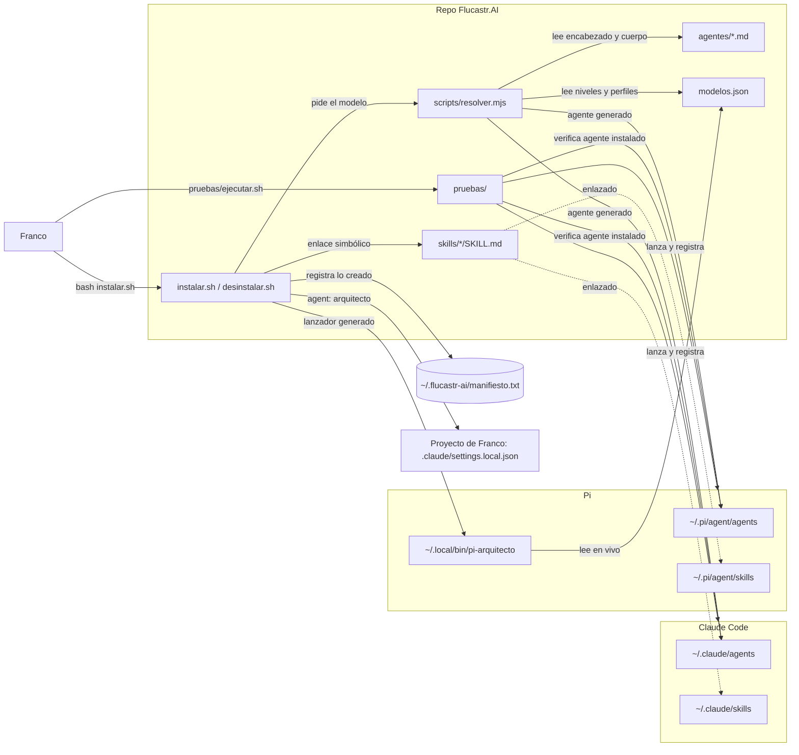

# Arquitectura — Flucastr.AI (modo: actual)

> Estado: **aprobado por Franco** (2026-10-29).

## Estructura y su razón

Un solo repo, `Flucastr.AI`: configuración, scripts y pruebas. Sin servicio en ejecución, sin base de datos y sin despliegue (confirmado, `REPOS.md`). Se instala en la máquina de Franco; separar repos no tiene razón concreta.

## Diagrama

## Componentes

| Componente | Responsabilidad | Tecnología | Origen |
|---|---|---|---|
| `agentes/` | Define cada agente. No declara modelo (el resolver rechaza `model:`). | Markdown con encabezado | `agentes/arquitecto.md`, `definicion/plan-pruebas-arquitecto.md` (I6) |
| `skills/` | Procedimientos que el agente carga por paso. | Markdown con encabezado | `skills/*/SKILL.md` |
| `modelos.json` | Fuente única de modelos: niveles, respaldo, perfiles, nivel por agente. | JSON | `modelos.json` |
| `scripts/resolver.mjs` | Resuelve nivel→perfil→modelo y genera los agentes por herramienta. | Node ESM | `README.md`, `definicion/arquitectura.md` |
| `instalar.sh` | Valida primero y después enlaza skills, genera agentes y lanzador de Pi, escribe manifiesto. Nunca pisa lo existente. | Bash | `instalar.sh` (cabecera y comentario de validación) |
| `desinstalar.sh` | Quita solo lo del manifiesto; borra generados únicamente si conservan la marca `flucastr-ai:generado`. | Bash | `README.md`, `definicion/arquitectura.md` |
| `pruebas/` | Capa 1 (instalación) y escenarios B, M, R con modelo; fixtures generados, remotos *bare* locales, comprobaciones duras con control negativo, registro estructurado e instantánea. | Bash + Node (`node --test`) | `pruebas/README.md`, `pruebas/ejecutar.sh` |
| Destinos Claude Code / Pi | Donde cada herramienta lee agentes y skills. | Carpetas en `~` | `instalar.sh`; que Pi lea `agents/` sin su paquete de subagentes **no está verificado** |

## Decisiones

| Decisión | Por qué | Descartado y por qué | Qué la cambiaría |
|---|---|---|---|
| Skills **enlazadas**, agentes **generados** | Skills idénticas en ambas herramientas; el agente necesita el modelo resuelto (inferido) | Copiar todo: no documentado | Que una herramienta no siga enlaces o cambie su formato |
| Manifiesto + marca de generado | Desinstalar exactamente lo instalado (`README.md`) | No documentado | — |
| Validar antes de actuar | Un `modelos.json` roto dejaba una instalación parcial o destruía la previa (defecto confirmado por la Capa 1 y corregido) | Validar al final | — |
| Pruebas contra el agente **instalado** | Es lo que Franco usa (`plan-pruebas-arquitecto.md`); el ejecutor se detiene si el instalado es el antiguo | Probar los archivos del repo | — |
| Skills bajo demanda | Mantener corto el agente | Todo en el agente | — |

## Evolución prevista (no existe hoy)

Tres roles más y un coordinador: `coordinador` (agente principal, delgado), `planificador` (backlog y tareas) y `constructor` (ejecuta una tarea). Franco abre solo el `coordinador`, que invoca a los demás como subagentes y se detiene en cuatro puertas de aprobación. Los roles se traspasan trabajo por archivos: `definitions/` → `definitions/BACKLOG.md` → `features/F01-nombre/task-NN-nombre.md` → `features/completed/`, con `definitions/STATUS.md` para el estado del flujo y los bloqueos. Ningún rol llama a otro: los bloqueos pasan por `STATUS.md`. Detalle en `PROJECT.md`, «Flujo de trabajo». No se dibuja en el diagrama porque no está construido. El arquitecto deja de ser el agente principal (cambio de una frase en `agentes/arquitecto.md`, de Franco).

## Supuestos y pendientes

- **Pendiente:** verificar que un agente principal de Pi invoque a otro por nombre (`npm:pi-subagents` está instalado).
- **Supuesto:** Pi lee `~/.pi/agent/agents/` mediante un paquete de subagentes (comentario en `instalar.sh`).
- **Pendiente:** si `instalar.sh` ya corrió en esta máquina; el informe del 2026-11-02 sugiere que el agente instalado de Claude Code es el antiguo y requiere reinstalar.
- **Pendiente:** visibilidad del remoto (la URL ya consta en `REPOS.md`).
- **Riesgo:** Pi se prueba solo por detección; no hay confinamiento de escritura ni de lectura de `.env`.

## Estado

Aprobado por Franco el 2026-10-29.
