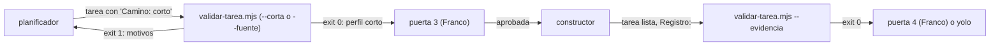

# Camino corto para cambios triviales

> Estado: borrador por aprobar (puerta 1). Autor: `arquitecto`, una sola pasada, 2026-11-02. Sin código.
> Origen: encargo de Franco (*confirmado*); lectura de `formato-tarea.mjs`, `formato-evidencia.mjs`, `validar-tarea.mjs`, `registrar.mjs` (regex de `Registro:`), `coordinador.md`, `planificador.md`, `WORKFLOW.md` §3, §6, §9.3, `CONTRATOS.md`, `CONSUMO.md` (*confirmado*). No leído: `consumo.mjs`, `ejecutar-tarea`, `descomponer-feature`, `formato-fuente.mjs` (lo que dependa de ellos va como *a verificar*).

## 1. Idea

Hoy toda tarea lleva diez secciones, `Fuente:` y dos pasadas del validador, aunque cambie una línea. El camino corto es un **perfil del mismo validador**: una tarea de siete a ocho secciones que `validar-tarea.mjs` acepta solo si cumple criterios mecánicos. No hay rol, estado ni archivo nuevos; el `coordinador` no cambia (0 B). Las puertas y el modo yolo quedan como están. Fuera de alcance (decidido con Franco): nivel de modelo por tarea y presupuesto por tamaño (F29).

## 2. Flujo



## 3. Quién clasifica

- **El script decide; el planificador solo propone.** El planificador declara `- Camino: corto` en *Contexto*. Sin esa línea, la tarea es larga y nada cambia. Con ella, el validador aplica el perfil corto: si algún criterio falla, sale con 1 y el planificador la reescribe larga. Nadie puede «declarar corta» una tarea que no pase.
- **`--corta <ruta>...`** (primer argumento, como `--fuente`): exige el perfil corto y falla si falta la línea. El planificador la corre de autocomprobación (solo lectura).
- **Despacho automático**: `--fuente` y el modo simple, que el `coordinador` ya corre en la puerta 3 y en yolo, detectan la línea `Camino: corto` y aplican el perfil corto (sin exigir `Fuente:`). **El `coordinador` no aprende nada nuevo**: mismo comando, mismo permiso `~/.flucastr-ai/validar-tarea.mjs *`.
- `--evidencia` no cambia: lee *Verificación*, *Evidencia* y *Notas* por título, y esas secciones siguen en la tarea corta (*confirmado* en `formato-evidencia.mjs`).

## 4. Criterios finales (todos, comprobados por script)

| # | Criterio | Por qué |
|---|---|---|
| K1 | Línea `- Camino: corto` en *Contexto* | Opt-in: sin ella no cambia nada para las 100+ tareas actuales |
| K2 | `Tocar:` con **exactamente 1** ruta (regla 11 ya la valida) | Un archivo = un diff revisable de un vistazo |
| K3 | *Decisiones abiertas* = `Ninguna` | Hace mecánico «sin decisiones abiertas»; el flujo `DECISION:` queda intacto |
| K4 | Ruta fuera de la lista protegida (§5) | Un cambio a `scripts/`, `agentes/`, `skills/` o `definitions/` altera el propio flujo y exige puerta 4 con diff |
| K5 | *Verificación* con **1 comando** en bloque de código y ≥1 línea `Esperado` con un fragmento entre comillas invertidas | Un comando basta si dice qué salida prueba; `--evidencia` ya exige ese fragmento literal |
| K6 | ≤3 pasos, *Descripción* ≤5 líneas, tarea ≤2048 caracteres | Fuerza brevedad; la larga permite 8 pasos y 8192 |
| K7 | Reglas comunes vigentes: línea 1 y 2, sin `TBD`/`a definir`/`según corresponda`, *Fuera de alcance:* con texto | Lo esencial no se relaja |

*Descartados:* decidir por extensión de archivo (un `.md` puede ser contrato) o por palabras de la *Descripción* (juicio disfrazado). *Qué cambiaría K6:* si Franco ve tareas cortas rechazadas por poco, subir a 3072 (decisión 1).

## 5. Lista protegida (K4)

Constante `RUTAS_PROTEGIDAS` en el módulo nuevo, por prefijo: `scripts/`, `agentes/`, `skills/`, `definitions/`, `pruebas/`, `.github/`; y por nombre: `AGENTS.md`, `instalar.sh`, `initialize.sh`, `package.json`, `package-lock.json`, cualquier `*.sh` y cualquier `.env*`. Añadí `pruebas/` y los instaladores a lo pedido porque también cambian el comportamiento del kit o debilitan sus guardas (*inferido*). Es lista negra: lo desconocido pasa a corta, y lo atrapa la puerta 3 de Franco, que sigue siendo una a una. Fallar aquí es seguro: la tarea vuelve al camino largo.

## 6. La tarea mínima

Ocho secciones `##` en este orden (se pierden *Decisiones ya tomadas* y *Criterios de aceptación*; el *Esperado* de *Verificación* hace de criterio):

```
# task-NN — título
repo: …   depende_de: …   estado: borrador

## Descripción        (qué y por qué, ≤5 líneas; si hay un dato ya decidido, va aquí)
## Contexto
- Camino: corto
- Tocar: `ruta`
## Decisiones abiertas
Ninguna
## Pasos              (1 a 3, numerados)
## Verificación       (un bloque con 1 comando + «Esperado: … `fragmento`»)
## Alcance / Fuera de alcance   (con «Fuera de alcance: …»)
## Evidencia
## Notas
```

Se mantienen los cinco esenciales (*Tocar*, *Verificación*, *Esperado*, *Fuera de alcance*, *Evidencia*) y se añade *Notas* porque ahí vive `Registro:`. Tamaño objetivo 1 a 1,5 KB frente a una mediana larga de ≤6 KB (*meta* de `CONTRATOS.md` §6).

**Implementación del validador (recomendada):** `validarTarea(texto, perfil = LARGO)` en `formato-tarea.mjs`, con el perfil como datos (lista de secciones, máximo de pasos, criterios sí/no, máximo de caracteres). Así las reglas 1, 2, 4, 5, 8, 10 y 11 son **una sola implementación** y no divergen. La elegibilidad (K1 a K6) va en `scripts/formato-corta.mjs`, función pura `motivosCorta(texto)`. Con el perfil por defecto, la salida es idéntica a hoy (se prueba con las fixtures existentes).

## 7. Puertas, yolo y fallos

- **Puerta 3**: igual, una tarea a la vez; revisar 1,5 KB es barato, no se junta. **Puerta 4**: igual (K4 asegura que el diff no toca `scripts/`).
- **Yolo (§9.3)**: sin cambios; el `coordinador` ya corre el validador para aprobar y `--evidencia` para `hecha`. Como K4 excluye `definitions/`, «cambios a `definitions/`: nunca en yolo» sigue sin tensión. Un solo repo ya lo exige yolo.
- **La tarea corta resulta no ser trivial**: el `constructor` aplica sus reglas de siempre (`DECISION:` o `BLOQUEO:` por cambio de alcance; dos fallas iguales = `bloqueada`). El `coordinador` la enruta como hoy; el planificador la reescribe larga. No hay regla nueva en ningún núcleo.

## 8. Registro y medición

Las 8 claves de `Registro:` son un regex cerrado en `registrar.mjs`; añadir una clave invalidaría líneas ya escritas. Por eso **no se pide nada al `constructor`**: `registrar.mjs` deriva `camino=corto|largo` del marcador de la tarea que ya lee y lo guarda como campo del evento (*inferido*: lee tareas por ruta; a verificar al descomponer). `consumo.mjs` separa sus cifras por `camino`.

| Cifra (por `camino`) | Fuente | Meta (*supuesta*) |
|---|---|---|
| Tareas cortas ÷ tareas | eventos | informativo |
| Tamaño mediano de tarea | eventos / archivo | corta ≤1,5 KB |
| `intentos` medio, `resultado=lista` | `Registro:` | corta ≥ larga (≥90 %) |
| `DECISION:` o `causa=alcance` en cortas | `Registro:` | ≤10 %; si no, K3 falla en la práctica y se endurece |
| Costo y turnos del `constructor` por tarea | `consumo.mjs` | −30 % frente a la larga |

*Supuesto sin medir:* que el ahorro venga sobre todo de tareas más cortas y sin `Fuente:`, no del `coordinador`. Si el costo por tarea no baja con ≥8 cortas, se revierte la tarea 3 (la skill) y queda el perfil inerte.

## 9. Dónde vive el texto (bytes)

- `agentes/coordinador.md` (6977/7168): **+0 B**. `planificador.md` (3581/3584): **+0 B** (no cabe nada).
- Skill nueva `camino-corto` (≤3 KB; descripción ≤160 caracteres): criterios, plantilla y cómo autocomprobar con `--corta`.
- Un puntero de una línea en `descomponer-feature` (ya se carga en la puerta 3): «Si el cambio cumple `camino-corto`, usa esa plantilla.» (*a verificar*: bytes libres de esa skill, tope 5 KB).
- Las frases protegidas nuevas entran en `FRASES_POR_ARCHIVO` (`skills/camino-corto`). `WORKFLOW.md` (sobre su tope) no se toca; `AGENTS.md` gana una línea que enlaza este archivo, al aprobarse.

## 10. Feature y tareas candidatas (para el planificador)

Feature candidata «Camino corto» (número lo asigna el backlog). Todas tocan `scripts/` o `skills/`, así que **van por el camino largo** (no se estrenan a sí mismas). Cada una ≤5 KB, con `git revert` limpio.

1. **Perfil parametrizable**: `validarTarea(texto, perfil)` con perfil `LARGO` por defecto, sin cambio de comportamiento. Verificación: pruebas y fixtures actuales verdes e idénticas.
2. **`formato-corta.mjs`**: perfil corto y `motivosCorta` (K1 a K6, `RUTAS_PROTEGIDAS`). Verificación: fixtures válida, y una inválida por criterio; la tarea de §6 pasa.
3. **CLI**: `--corta` y despacho por marcador en `--fuente`/simple; pruebas de salida 0/1/2; el instalador copia `formato-corta.mjs` (import estático: si falta, **todo** `validar-tarea.mjs` falla). Depende de 2.
4. **Skill `camino-corto`** + puntero en `descomponer-feature` + manifiesto de frases + topes de bytes. Depende de 3.
5. **`registrar.mjs` deriva `camino`** y `REGISTRO.md` lo documenta (esa edición de `definitions/` la hace Franco o pasa por puerta 1). Independiente de 1 a 4.
6. **`consumo.mjs` separa por `camino`**. Depende de 5.
7. **Medición** en una feature real con ≥8 cortas; informe pegado por Franco.

## 11. Riesgos

- **Regresión en el validador de todas las tareas** (tareas 1 y 3): mitigación, perfil por defecto idéntico, fixtures actuales, y `git diff scripts/` en la puerta 4.
- **Módulo no instalado** rompe la puerta 3 entera: prueba de instalación en la tarea 3 (mismo riesgo *a verificar* de F29).
- **Inflación de «cortas»**: acotada por K1 a K6 y por la puerta 3. **Subclasificación** (todo largo) solo pierde el ahorro.
- **«Ninguna» falsa en K3**: el `constructor` responde `DECISION:`; se mide en §8.
- **Lista negra incompleta** en repos de producto: aceptado, la atrapa Franco en la puerta 3.
- **`ejecutar-tarea`/`descomponer-feature` o pruebas con fixtures de diez secciones** podrían suponer la plantilla larga (*no leído*): se revisa en la tarea 4.
- **Pi**: que cargue la skill a pedido no está verificado (mismo *supuesto* que F28).

## 12. Decisiones para Franco

1. **Tope de tamaño (K6).** A) 2048 caracteres (**recomendada**). B) 1536, más estricto. C) 3072, más tareas elegibles.
2. **Cómo se declara y despacha.** A) línea `Camino: corto` en *Contexto*, `--corta` explícita y despacho automático en `--fuente` (**recomendada**: 0 B en núcleos). B) solo `--corta` y el `coordinador` debe elegir comando (cuesta bytes que no tiene). C) marcador en la segunda línea (cambia la regla 2 de todas las tareas).
3. **Registro.** A) `registrar.mjs` deriva `camino` del marcador (**recomendada**). B) campo opcional escrito por el `constructor` (toca regex, skill y líneas históricas). C) no registrar; medir solo por tamaño de tarea.
4. **Puerta 3 de las cortas.** A) igual, una a una (**recomendada**). B) aprobación conjunta de las cortas de una feature (menos pausas, pero cambia §3 y §6 de `WORKFLOW.md`). C) sin puerta 3 (descartada: es yolo implícito).

Tamaño de la pasada:    11384 bytes
