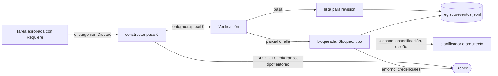

# Diagnóstico de bloqueos y telemetría

> Estado: borrador por aprobar
> Fecha: 2026-11-02. Una sola pasada del `arquitecto`; sin código. No depende de `CAMINO-CORTO.md`.
> Origen: evidencia medida por Franco hoy (*confirmado*, dada en el encargo, no reinterpretada) y lectura de `formato-tarea.mjs`, `formato-evidencia.mjs`, `validar-tarea.mjs`, `registrar.mjs`, `consumo.mjs`, `agentes/constructor.md`, `skills/ejecutar-tarea`, `WORKFLOW.md`, `CONTRATOS.md` (*confirmado*). Lo marcado *inferido* no se pudo comprobar: no leí tareas de otros proyectos.

## 1. Diagnóstico

| Hallazgo | Estado del dato |
|---|---|
| El bloqueo de F02 (DonFinancio) fue de **entorno** (Playwright, Node 24, Docker/WSL, puerto 55432, comando de 240 s). Ningún rol de `agentes/` puede arreglar un entorno, pero cada reintento volvió por coordinador→planificador/arquitecto, el tramo más caro | *confirmado* (Franco) |
| Hoy no existe forma de declarar el entorno que exige una tarea: `Contexto` solo exige `- Tocar:` y las 10 secciones son exactas (`formato-tarea.mjs`, reglas 3 y 11) | *confirmado* (código) |
| La regla «`lista` solo con `pasa`» **ya existe**: `formato-evidencia.mjs` exige `resultado=lista`, `causa=ninguna` y `verificacion=pasa` si el estado es `lista para revisión` o `hecha`; con `causa=parcial` exige `resultado=bloqueada` | *confirmado* (código) |
| Entonces los tres `parcial`+`lista` se colaron por **falta de aplicación**: (a) `--evidencia` solo corre «si existe `scripts/validar-tarea.mjs`» en el repo (`ejecutar-tarea` paso 3) y esos proyectos usan el lanzador de `~/.flucastr-ai`; (b) `registrar.mjs` acepta cualquier combinación de claves y cuenta esa `lista` en la telemetría; (c) Franco puede dejar `hecha` sin correr nada | *inferido* (a, c); *confirmado* (b) |
| `cancelada` **no** es estado del flujo: no está en `WORKFLOW.md` §6 ni en `ESTADOS_TAREA` de `registrar.mjs`, y `RE_SEGUNDA` de `formato-tarea.mjs` rechazaría `estado: cancelada`. Las 15 de DonFinancio se hicieron fuera del contrato y sin motivo | *confirmado* (grep y código) |

Conclusión: el costo está en planificar y diseñar (constructor 3-4 %); los bloqueos baratos de evitar (entorno, tareas descartadas, evidencia mal etiquetada) no dejan rastro de **por qué** ocurrieron. El 31-33 % del coordinador en `STATUS.md` es de F29 y queda fuera.

## 2. Flujo propuesto de un bloqueo

## 3. Pieza 2 — Coherencia de `resultado` (primera: la más chica)

**Regla (ya vigente, se cierra su aplicación).** `resultado=lista` ⇔ `verificacion=pasa` ∧ `causa=ninguna`. Resultado correcto en los otros casos (ya definido en `ejecutar-tarea`, línea de `Registro:`; no se inventa nada):

| Verificación | Estado de la tarea | `Registro:` | Primera línea |
|---|---|---|---|
| `parcial` | `bloqueada` | `resultado=bloqueada; causa=parcial` | `PARCIAL:` |
| `falla` (2.ª pasada) | `bloqueada` | `resultado=bloqueada; causa=verificacion_x2; intentos=2` | `BLOQUEO:` |
| `falla` por otra causa | `bloqueada` | `resultado=bloqueada; causa=<otra>` | `BLOQUEO:` |

**Cambios mecánicos.**
1. Función pura `coherenciaRegistro({estado, verificacion, resultado, causa, intentos})` en `formato-evidencia.mjs`, extraída del bloque `exigidos` actual (misma lógica; el mensaje añade el valor correcto, p. ej. «con verificacion=parcial usa resultado=bloqueada; causa=parcial»).
2. `registrar.mjs` la usa al leer `Registro:`: una línea incoherente cuenta en `invalidas` y no emite `ejecucion` con `resultado=lista`. Una sola fuente de verdad para validador y telemetría.
3. `ejecutar-tarea`: una frase, «`lista` exige `pasa`; si no, `bloqueada`», y la forma de llamar a `--evidencia` por el lanzador cuando el repo no tiene `scripts/` (nombre a confirmar).

## 4. Pieza 1 — Puerta de entorno

**Línea `- Requiere:`** dentro de `## Contexto`, junto a `- Tocar:` (no es sección nueva: las 10 siguen exactas). Valor `ninguno` o lista separada por `, ` de un vocabulario cerrado:

`docker`, `navegador`, `red`, `puerto:<n>`, `runtime:<nombre>@<versión>`, `largo:<segundos>`.

- **Quién la propone:** el `planificador`, al descomponer, según la *Verificación* que escribe (regla en la skill `descomponer-feature`, ≤ 250 B; tope de 3584 B intacto).
- **Quién comprueba:** `scripts/entorno.mjs <tarea>` (nuevo, función pura + CLI, sin shell; exit 0 ok, 1 falta algo, 2 uso). Sondas: `docker info`; `node --version` contra `runtime:`; intento de escucha en el puerto (ocupado = falla); resolución DNS para `red`; binario/instalación del navegador para `navegador`. Imprime `falta=docker,puerto:55432`.
- **Cuándo y a quién avisa (decisión 1):** antes de tocar nada, y si falla el aviso va solo a Franco: `BLOQUEO: rol=franco; motivo=entorno: falta=<lista>`, tarea `bloqueada`, sin enrutar. El texto vive en `ejecutar-tarea` (constructor ≤ 3072 B: no entra a `agentes/constructor.md`).
- **Cómo se registra:** línea `Bloqueo:` (ver §5), antes de `Registro:`, con `causa=otra` en este (no se toca el regex).
- **Comandos > 240 s:** `largo:<s>` documenta el caso. Regla para el planificador: cada comando de *Verificación* se diseña para ≤ 180 s (margen bajo el corte); si una suite no cabe, se parte en comandos por subconjunto. Si el corte ocurre igual, el constructor no lo reintenta: `Bloqueo: tipo=entorno; falta=largo`, `verificacion=parcial`, resultado `bloqueada` (pieza 2).
- **Sin `Requiere:`:** `entorno.mjs --sugerir` busca en *Verificación* (`docker`, `playwright`, `localhost:NNNN`) y sugiere la línea; no bloquea.

## 5. Pieza 3 — Telemetría que da pistas

**Qué se registra** (todo cerrado; sin texto libre, por la regla de privacidad de `registrar.mjs`):

| Dato | Dónde | Cómo |
|---|---|---|
| Causa del bloqueo | Línea `Bloqueo: tipo=<entorno\|alcance\|especificacion\|decision_diseno\|verificacion_x2\|credenciales\|otra>; falta=<vocabulario de Requiere o ->` en *Notas*, **antes** de `Registro:` (la última línea no vacía sigue siendo `Registro:`; el regex de 8 claves no cambia) | La escribe el constructor; `registrar.mjs` suma el evento `bloqueo` (entrada nueva en `ESQUEMA`) |
| Vueltas por bloqueo | Sin campo nuevo: transiciones `bloqueada`→`aprobada`/`en curso` por tarea en los `tarea_estado` que ya existen | Derivado; «quién lo resolvió» no se mide (el `por` es inferido, `REGISTRO.md`) |
| Motivo de cancelación | `Cancelada: motivo=<replanificada\|obsoleta\|duplicada\|fuera_de_alcance\|otra>` en *Notas* y `cancelada` como estado (decisión 2) | `registrar.mjs` añade `cancelada` a `ESTADOS_TAREA` |
| Origen de cada delegación | Línea `Disparó: <puerta N \| BLOQUEO task-NN \| franco \| reintento>` en el encargo (decisión 4) | `consumo.mjs` la lee del texto del encargo en el log de sesión (*inferido*: el planificador confirma que el prompt del subagente queda en el log) |
| Costo por tarea | `consumo.mjs --por-tarea`: costo de los turnos cuya ruta calza `FORMA_TAREA`, agrupado por tarea y por estado final; muestra solo `hecha` y los bloqueos con su costo | Reutiliza `clasificarTurno`; la unión tarea↔subagente es *inferida* |

**Cómo se lee, con un comando:** `node scripts/informe.mjs --consumo <dir> --pistas` (ya une `registro/eventos.jsonl` con las sesiones). Imprime hasta 5 pistas, cada una con la medición que la dispara y la acción:

| Se dispara si | Pista |
|---|---|
| ≥ 2 bloqueos `tipo=entorno` en una feature | «Añade `Requiere:` a sus tareas o arregla el entorno antes de aprobar» |
| ≥ 1 bloqueo `tipo=entorno` que volvió a planificador/arquitecto (por `Disparó:`) | «Esa vuelta no podía arreglarlo: usa `rol=franco`» |
| tareas `cancelada` / total de la feature > 30 % | «Se planifica de más: baja el tamaño de la feature o valida la idea antes de descomponer» |
| `cancelada` sin motivo, o líneas `Registro:` incoherentes (`invalidas`) | «Corre la validación con el lanzador; falta aplicar §3» |
| `alcance` o `especificacion` ≥ 2 | «El planificador omite decisiones: revisa `Fuente:` y *Decisiones ya tomadas*» |
| Costo de arquitecto+planificador > 60 % del total | «Pocos bloques de ejecución para el costo de definir: junta features chicas» |

Los umbrales son supuestos a calibrar con datos reales.

## 6. Desglose para el planificador (el planificador numera; tareas ≤ 3 rutas)

**Feature A — Coherencia de resultado (hacer primero; autoprobable con el propio validador)**
- A1 `coherenciaRegistro` en `formato-evidencia.mjs` + pruebas (cruza los tres `parcial`+`lista` y el caso F26 `falla`).
- A2 `registrar.mjs` usa A1; informe no cuenta esas `lista`.
- A3 Frase en `ejecutar-tarea` y mensaje con el valor correcto.

**Feature B — Puerta de entorno**
- B1 Plantilla `Requiere:` en `WORKFLOW.md` §6 y regla en `descomponer-feature`.
- B2 `scripts/entorno.mjs` (+ `--sugerir`) y pruebas con sondas simuladas.
- B3 Paso 0 y `BLOQUEO: rol=franco` en `ejecutar-tarea`; verificar que el coordinador no enruta `rol=franco`.
- B4 Regla de comandos ≤ 180 s y caso `largo`.

**Feature C — Telemetría**
- C1 Línea `Bloqueo:` + evento `bloqueo` en `registrar.mjs`.
- C2 Estado `cancelada` + `Cancelada:` (validador de tarea y `registrar.mjs`).
- C3 `Disparó:` en la plantilla de encargo y su lectura en `consumo.mjs`.
- C4 `consumo.mjs --por-tarea`.
- C5 `informe.mjs --pistas`.

**Orden:** A → B → C (A es la más chica; C1 usa el vocabulario de B; C5 al final porque necesita C1-C4).

## 7. Riesgos

| Riesgo | Mitigación |
|---|---|
| Regresión del validador en tareas F24-F29 y en los repos de pruebas | `Requiere:`, `Bloqueo:` y `Cancelada:` son **opcionales**; se corre el validador antes y después sobre las tareas que hoy dan exit 0 y el resultado debe ser idéntico, salvo por las incoherentes de §3 |
| Tareas de otros proyectos sin `Requiere:`/`Registro:` | Ausencia = `ninguno` / `sin_dato`; `entorno.mjs` avisa, no bloquea; `registrar.mjs --reconstruir` cuenta incoherentes como `invalidas`, no las borra |
| El núcleo del coordinador (6977 B, tope 7168: quedan 191 B) crece | Todo texto nuevo va en skills/scripts; solo `Disparó:` toca el núcleo (≈ 40 B, se mide antes de aprobar) |
| `rol=franco` mal enrutado por el coordinador | Prueba de contrato en B3 |
| Sondas con falsos positivos (puerto de otra tarea) | El aviso muestra la sonda; Franco decide; el script nunca mata procesos |

## 8. Decisiones para Franco

1. **¿Quién comprueba el entorno y cuándo?**
   - A) El constructor, como paso 0, sin tocar nada (sin comando nuevo; cuesta un turno de constructor, ≈ 3-4 % del costo). **Recomendada**: evita la vuelta cara sin ampliar la lista cerrada.
   - B) El coordinador corre `node scripts/entorno.mjs <tarea>` antes de delegar (agrega un comando a la lista cerrada de `WORKFLOW.md` §3.1; es lo más barato por intento, pero ensancha el permiso).
   - C) Solo Franco, a mano, antes de aprobar la tarea.
2. **¿`cancelada` pasa a ser estado del flujo?**
   - A) Sí, con `Cancelada: motivo=…` obligatorio. **Recomendada**: formaliza lo que ya ocurre y da la cifra del descarte.
   - B) No; lo descartado se borra o archiva con la razón en `BACKLOG.md`.
   - C) Se deja como está (sin validar ni registrar).
3. **¿Qué hace `registrar.mjs` con registros incoherentes históricos?**
   - A) Los cuenta en `invalidas` y no los suma a `lista`. **Recomendada**.
   - B) Los excluye del todo.
   - C) No se toca; solo se endurece `--evidencia`.
4. **¿`Disparó:` en el encargo?**
   - A) En el núcleo del coordinador, ≈ 40 B (cabe en 191 B; se mide antes de aprobar). **Recomendada**: la trazabilidad exige que siempre esté.
   - B) En la skill `comandos-coordinador` (no siempre cargada: trazabilidad parcial).
   - C) No se registra; la origen se deduce de `STATUS.md`.

Tamaño de la pasada: 12284 bytes
