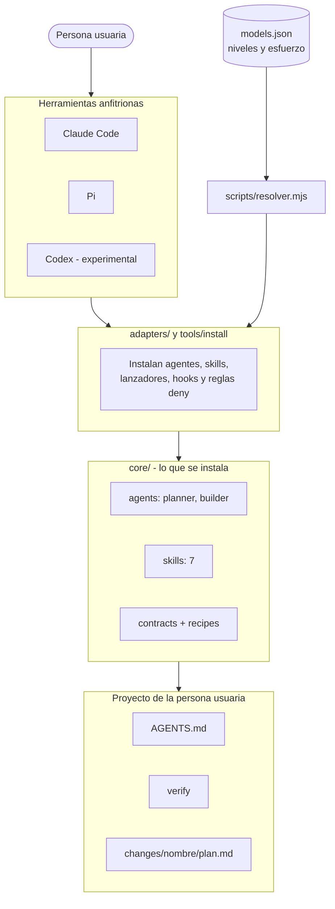
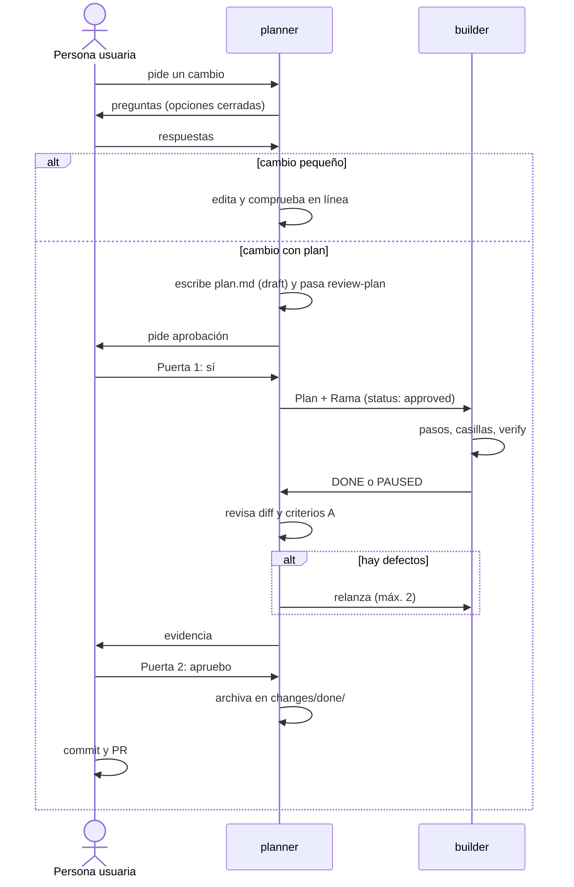
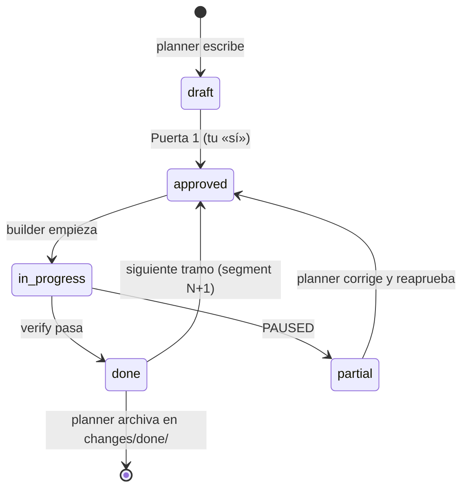
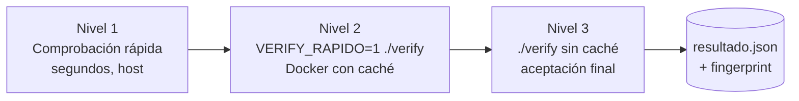
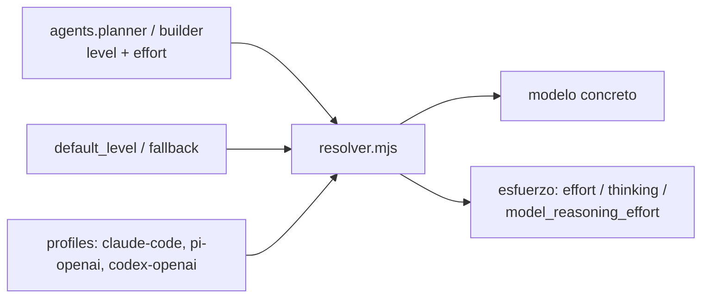
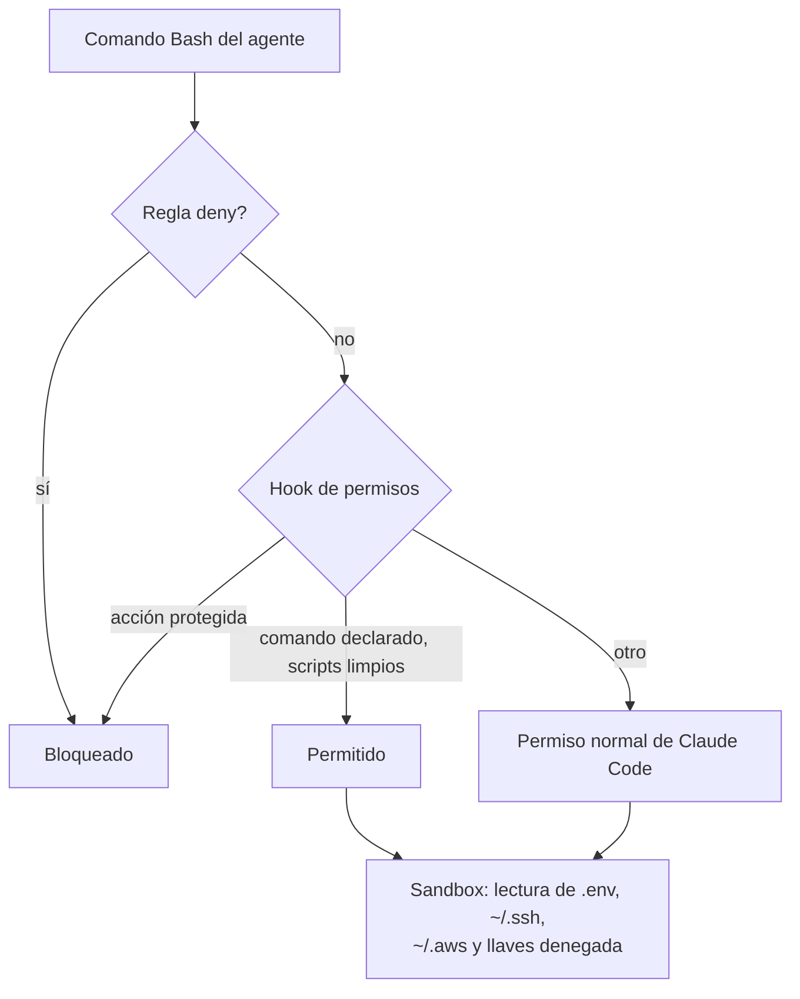
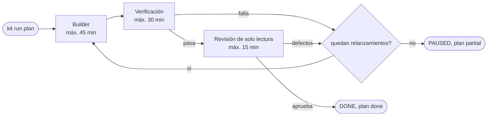

# Qué tenemos implementado (v2)

Documento de lectura para entender el kit completo. Estado al 2026-11-19. Para el detalle de cada pieza, sigue los enlaces a archivos; este documento no los reemplaza.

## 1. Qué es Flucastr.AI

Un kit de **agentes y skills** para trabajar con IA en tres herramientas: **Claude Code**, **Pi** y **Codex** (Codex es experimental). No es una aplicación: es un conjunto de instrucciones, scripts e instaladores que dejan a la IA trabajando con un proceso fijo, con control humano en dos puntos.

- Versión 2 en `main`, **candidata**: funciona en este repo, falta probarla en proyectos reales (ver `TODO.md`).
- La v1 está en `old/v1/` y en el tag `kit-v1`. No se ejecuta ni se mantiene.

### Arquitectura en capas



## 2. La idea central: dos agentes y dos puertas

| Pieza | Quién | Qué hace |
|---|---|---|
| `planner` | agente (nivel medio, esfuerzo `medium`) | Entiende lo que pides, investiga, diagnostica, escribe el plan, lo delega y revisa el resultado. |
| `builder` | agente (nivel bajo, esfuerzo `high`) | Ejecuta un plan aprobado, corre `verify` y deja evidencia. No cierra nada ni hace commit. |
| Puerta 1 | persona usuaria | Aprueba `changes/<nombre>/plan.md` antes de construir. |
| Puerta 2 | persona usuaria | Revisa la evidencia y decide el commit. |

Definiciones: `core/agents/planner.md` y `core/agents/builder.md`.

**El único traspaso entre agentes es el archivo `changes/<nombre>/plan.md`.** El builder no ve la conversación; solo sabe lo que el plan dice.

### Flujo de un cambio

1. **Explorar.** El planner lee `AGENTS.md` y el código, y hace todas las preguntas de comportamiento y alcance (con opciones cerradas).
2. **Evaluar y validar.** Compara opciones por beneficio, costo y riesgo, y confirma contigo la decisión.
3. **Elegir tamaño.** Si es un *cambio pequeño*, lo edita él mismo en línea. Si no, escribe un plan.
4. **Puerta 1.** Antes de pedirte aprobación pasa el revisor de planes (`scripts/review-plan.mjs`). Tú apruebas y el plan queda `status: approved`.
5. **Delegar.** Comprueba que la rama base esté limpia y al día, y lanza al builder (como subagente, o en ventana propia).
6. **Construir.** El builder marca cada casilla apenas la comprueba, corre `verify` y termina con `DONE` o `PAUSED`.
7. **Revisar.** El planner mira el diff, cada criterio de aceptación y, si el riesgo es alto, corre la verificación. Veredicto: `APPROVED`, `RETURNED` o `PAUSED`. Un defecto se devuelve al builder (hasta 2 relanzamientos).
8. **Puerta 2 y cierre.** Tú revisas la evidencia. El planner actualiza `AGENTS.md`, mueve la carpeta a `changes/done/` y te pide el commit y luego el PR hacia la rama `base:`.



El planner **no cierra el turno tras un avance parcial**: solo se detiene por una pregunta pendiente, Gate 1, Gate 2, un builder en ejecución o un bloqueo real.

### Cambio pequeño

El planner edita sin plan ni builder solo si se cumplen las seis condiciones: una intención; un repo, hasta 2 archivos de producto y 30 líneas; corrección, texto, estilo o configuración no sensible; sin tocar datos, seguridad, dinero, contratos, rutas, dependencias, Docker/`verify` ni despliegue; comprobación ejecutable escrita antes; y que no hayas pedido plan. Ante la duda, va por builder. Puedes vetarlo diciendo «por plan».

### Qué bloquea y qué no

Solo bloquean cuatro cosas: **commit**, **secretos** (leer `.env`, llaves, credenciales), **tests de aceptación alterados** y **`verify` en rojo**. Que falte una línea en `AGENTS.md` no bloquea nada.

## 3. El plan (`changes/<nombre>/plan.md`)

Lo describe la skill `core/skills/plan-change/SKILL.md`. Estructura:

- **Encabezado:** `status`, `branch`, `base`, `repos` (carpetas que toca; `[.]` si es un solo repo), `executor`, `segment`, `continuity`, `type`.
- **Secciones:** Objetivo, Exploración, Evaluación, Supuestos, Decisiones ya tomadas, Validación, Alcance, Verificación, Condiciones de parada, Pasos, Evidencia, Notas.
- **Historias y tramos:** cada historia trae dependencias, contratos a mantener, rutas probables, ejemplo, criterios `A1..An` (escenario → comprobación → resultado esperado), pasos atómicos con su comprobación, verificación del tramo y traspaso.
- **Estados:** `draft` (planner) → `approved` (planner, tras tu «sí») → `in progress` (builder) → `done` o `partial` (builder). Cerrar no cambia el estado: la carpeta en `changes/done/` es la marca.



Reglas notables: alcance por ruta y no por archivo; una sola verificación final; pasos de una línea; un tramo toca hasta tres archivos de producto; `type: docs` usa verificación liviana (`git diff --check` y existencia de rutas); si el cambio toca pantallas se hace antes `design-experience`.

### Tramos y continuidad

Un cambio largo se parte en tramos (`### Segment N`), a veces en archivos `tramo-N.md` con un `plan.md` índice. Por defecto el builder hace **un tramo** y espera la revisión. Con `continuity: continuous` completa las historias aprobadas de punta a punta, con condiciones de parada (mismo fallo dos veces, salir del alcance, falta una decisión tuya, o una comprobación que tarda más del doble de lo medido) y un punto de control por tramo. Evidencia de uso real: `docs/evaluaciones/tramos.md`.

### Retorno del builder

Primera línea siempre una de estas:

- `DONE: plan=<ruta>; segment=<n>; verify=pasa`
- `PAUSED: plan=<ruta>; segment=<n>; motivo=<ambiguous|design|scope|access|verify>; hecho=<n>/<total>; siguiente=<paso>; no_intentado=<razón>`

Si preguntas «¿cómo va?», el planner responde en hasta cuatro líneas con las casillas del tramo activo, el último paso, el estado de Git y la razón de detención, sin molestar al builder.

## 4. Skills (`core/skills/`)

| Skill | Cuándo se usa |
|---|---|
| `plan-change` | Escribir el plan de un cambio de varios pasos. |
| `execute-plan` | Lo que sigue el builder para aplicar un plan aprobado. |
| `prepare-project` | Proyecto sin `AGENTS.md` o sin `verify`: deja un `AGENTS.md` corto y un `verify` que construye, arranca y recorre un flujo real. También cubre workspaces y la revisión de despliegue. |
| `define-project` | Proyecto nuevo y vacío: hasta 5 preguntas cerradas, escribe `AGENTS.md` y `docs/proyecto.md`, y se detiene. |
| `migrate-project` | Termina la migración de un proyecto de la v1 a la v2 tras `install.sh --migrate`. |
| `design-experience` | Antes de planificar una UI: boceto ASCII que apruebas en la terminal (`docs/experiencia.md` y `changes/<nombre>/pantallas.md`). |
| `diagnose` | A pedido («diagnostica»): solo lectura, dice qué falta, cuánto cuesta hoy y una mejora. Usa `core/skills/diagnose/diagnose.mjs`. |

## 5. Verificación

### Contrato por capacidades

`core/contracts/verification.md`: el kit pide capacidades, no herramientas. Cada proyecto declara en su `AGENTS.md` un comando por capacidad:

- **Rápida** (`Comprobación rápida:`): segundos, en el host, sin servicios. Nivel 1.
- **Servicio** (`Servicio:`): lógica contra dependencias reales. Nivel 2.
- **Aceptación** (`Acceptance:`): un archivo por flujo, filtrable; no corta en el primer fallo. Nivel 3.
- **Evidencia** (`Evidencia:`): dónde se escribe `resultado.json` (con `fingerprint`, `level`, `fase`, `ok`, `fallo`).

La *fingerprint* es un hash de `git status` y `git diff` de cada repo del plan, excluyendo `changes/`; sirve para saber si lo verificado cambió. Receta por stack: `core/recipes/node-pnpm.md`.



### Niveles

1. `Comprobación rápida`. 2. `VERIFY_RAPIDO=1 ./verify` (Docker con caché). 3. `./verify` sin caché (aceptación final). «Hecho» significa que `./verify` pasa desde cero. Riesgo bajo (cambio pequeño o `type: docs`) no repite `verify` en la revisión.

### `./verify` del kit

Es el script de la raíz; sus pasos viven en `tools/verify/*.sh`. Comprueba coherencia de `models.json`, ayuda e instalación (`--dry-run` no escribe nada), resolución de modelos para las tres herramientas, skills completas, permisos por proyecto, migración, workspaces, contratos del planner/builder, lanzadores (incluido Codex), pruebas de uso y de `kit run`, observador de Docker y el contrato del cambio pequeño. Termina con `VERIFY OK`. Estas pruebas son deterministas: no miden la fiabilidad del modelo.

`VERIFY_TARGET=<url> ./verify` corre solo el recorrido contra un despliegue (solo lectura salvo `VERIFY_PERMITIR_ESCRITURA=1`).

#### Temporales y salida de `./verify`

- Un solo temporal por corrida: `tools/verify/envoltorio.sh` crea `flucastr-verify.XXXXXX` bajo `${TMPDIR:-/tmp}`, lo exporta como `TMPDIR` a todos los pasos y lo borra con `trap` al salir, también con INT (130) y TERM (143). Varios pasos ponen su propio `trap EXIT`: corren como hijo del envoltorio y sus temporales caen dentro de ese `TMPDIR`, así que el envoltorio los limpia igual. El envoltorio es el único dueño del temporal de la corrida.
- Barrido: antes de crear nada, el envoltorio y `kit run` borran los `flucastr-verify.*` que sean directorios reales de más de 120 minutos bajo esa misma base y del mismo uid que quien ejecuta; los de otro dueño se dejan. No siguen enlaces y no tocan archivos ni otros nombres.
- Espacio libre: si la base tiene menos de 500 MB (`VERIFY_MIN_LIBRE_MB` lo cambia), `./verify` sale con 1 y `FALLO: sin espacio libre…` sin correr pasos.
- Salida: en verde imprime como mucho 5 líneas: `verify: <n> pasos; detalle en pruebas/.temporales/verify.log`, el registro de `kit-verificado` (`resultado registrado: …` o `no se registra: motivo=…`, como mucho 3 líneas) y `VERIFY OK`. En rojo imprime el encabezado `== <id>. …` del paso fallido, su cola (≤ 30 líneas y ≤ 3000 bytes), el registro (≤ 3 líneas) y `VERIFY FALLO: paso <id> (exit <n>); detalle en <log>`; en total ≤ 40 líneas y ≤ 4096 bytes. Sin encabezado de paso, imprime la cola del log, el registro y `VERIFY FALLO: sin paso`. El registro se añade al final del log después de imprimir, así la cola no lo repite.
- Log: `pruebas/.temporales/verify.log` tiene toda la salida de la corrida. Se trunca al iniciar y no se borra al salir. Es la única ruta de detalle.
- Con `VERIFY_TARGET` corre igual y no registra nada en `kit-verificado`.
- Paso 24 de `./verify`: `node --test tests/temporales/*.test.mjs` (barrido, envoltorio y espacio libre). `estatico.test.mjs` escanea `verify`, `install*.sh`, `uninstall.sh`, `tools/`, `scripts/`, `tests/`, `adapters/` y `core/` (`.sh`, `.mjs`, `.js`, `.cjs`) y falla si un `mktemp`/`mkdtemp` no tiene limpieza: `mktemp` sin variable o sin `trap … EXIT` con su variable (fuera de `tools/verify/`), `-p` o plantilla `/…`, `mkdtemp` sin `rm` o sin `finally`/`after`, o `/tmp/` literal. Las excepciones van con motivo en el propio archivo; una excepción que ya no coincide falla. Es una heurística textual, no un parser.
- Límite conocido: la prueba estática no ve creaciones hechas con variables construidas en otra línea ni con rutas calculadas; el envoltorio y la prueba de barrido sí cubren lo que sí se ejecuta.

### Pruebas (`tests/`)

Índice en `tests/README.md`. Los tres flujos de aceptación se corren con `node --test tests/acceptance/*.test.mjs` (`builder-contract`, `kit-run`, `uso`). Hay además suites de diagnóstico, permisos, migración, revisión de planes y continuidad.

## 6. Modelos y esfuerzo (`models.json`)

Los agentes declaran **nivel** (`high`, `medium`, `low`), nunca un modelo. `models.json` lo traduce por herramienta:

| Nivel | Claude Code | Pi | Codex |
|---|---|---|---|
| high | `claude-opus-5-5` | `openai/gpt-6.1-sol` | `gpt-6.1-sol` |
| medium | `claude-sonnet-5-5` | `openai/gpt-6.1-terra` | `gpt-6.1-terra` |
| low | `claude-haiku-5-5` | `openai/gpt-6-luna` | `gpt-6-luna` |

- `planner`: medio, esfuerzo `medium`, compacta a 60 000 tokens. `builder`: bajo, esfuerzo `high`.
- El esfuerzo se traduce a `effort` (Claude Code), `thinking` (Pi) o `model_reasoning_effort` (Codex; `max` se escribe `xhigh`).
- `kit_run.reviewer` (medio, esfuerzo `low`) define el revisor de `kit run`; sin esa clave, es el planner.
- La resolución la hace `scripts/resolver.mjs` (con piezas en `tools/resolver/` y `tools/model-resolution/`).



El planner no rinde en nivel bajo (probado 2026-11-09); el ahorro se logra con el esfuerzo.

## 7. Instalación y lanzadores

```bash
bash install.sh                    # global, en las herramientas que detecta
bash install.sh --dry-run          # muestra sin escribir
bash install.sh --project <ruta>   # además fija agente, reglas deny y sandbox en un proyecto
bash install.sh --migrate <ruta>   # migra un proyecto de la v1 (solo Claude Code)
bash uninstall.sh                  # quita lo que creó el kit
```

Opciones: `--copy`, `--only claude|pi|codex`, `--agent`, `--project-skills`, `--migrate-names`. También existe `install-remote.sh` (instalación remota, aún sin probar). Las piezas están en `adapters/` (`claude-code`, `pi`, `codex`, `shared`) y `tools/install/`.

`install.sh` crea los lanzadores `claude-<agente>`, `pi-<agente>` y `codex-<agente>` para correr un agente en ventana propia con el esfuerzo de `models.json`. Primer mensaje: `Plan: <ruta>` y `Rama: <rama>`.

## 8. Permisos y seguridad

Detalle en `docs/reglas-deny.md`.

- **Claude Code:** reglas `deny` (commit, push, merge, `gh pr create/merge`, `git -C/-c … commit`, `bash -c`, `sh -c`, `zsh -c`, leer `.env`), un **hook solo para Bash** (`scripts/permissions-hook.mjs`) y sandbox con restricciones de lectura (`.env`, `~/.ssh`, `~/.aws`, llaves). El hook permite el comando declarado, niega las acciones protegidas y deja el resto al permiso normal.
- **Codex:** reglas `prefix_rule` en `.codex/rules/flucastr.rules`, más restrictivas y experimentales; no cubren leer `.env`.
- **Pi:** sin equivalente; rige solo el prompt del agente.


- Son una barrera, no una frontera: no cubren `sudo`, `env <cmd>` ni un script que abra `.env`.

Reglas para los agentes: no hacen commit, push, PR, merge ni despliegue; no leen `.env`; el único Git de escritura permitido es `git switch -c <prefijo>/<nombre>` (`feature/`, `fix/`, `chore/`, `docs/`).

## 9. Herramientas auxiliares (`scripts/`)

| Comando | Para qué |
|---|---|
| `node scripts/kit-run.mjs <plan> --tool codex` | Automatiza ejecutar → verificar → revisar un plan aprobado (`docs/kit-run.md`). Hasta 2 relanzamientos; devuelve `DONE` (código 0) o `PAUSED` (1). |
| `node scripts/review-plan.mjs <plan>` | Revisor heurístico de planes antes de pedir aprobación. |
| `node scripts/usage.mjs` | Medidor de costos de solo lectura: tokens por día, proyecto y modelo; con `--sessions`, créditos estimados. Informe en `docs/evaluaciones/costos.md`. |
| `node scripts/observe.mjs start\|status\|stop\|report` | Observador de Docker (datos en `~/.flucastr-ai/observador/`, nada sale del equipo). |

Ciclo de `kit run`:



## 10. Mapa del repositorio

- `core/`: agentes, skills, contrato de verificación y recetas.
- `adapters/`: integración con Claude Code, Pi y Codex.
- `tools/`: piezas internas de instalación, resolución, ejecución, uso y `verify`.
- `scripts/`: comandos de uso (arriba).
- `tests/`, `evals/`: pruebas del kit y evaluaciones (`evals/arquitectura-cambios/` es un piloto sin modelos medidos).
- `docs/`: guía de uso (`docs/guide.md`), decisiones, evaluaciones, investigaciones, prácticas por tecnología.
- `changes/`: planes en curso; `changes/done/` guarda 68 cambios cerrados con su evidencia.
- `old/`: la v1, conservada.

## 11. Estado actual

**Probado:** el ciclo planner → plan → builder → `verify` en este repo; `./verify` falla donde debe; las reglas deny con Claude Code real; migración de v1 sobre una copia; Pi en lo básico; Codex solo en su generación e instalación.

**Pendiente** (`TODO.md`): usarla en un proyecto real con web, API y base de datos; probar la instalación remota; un plan de varios archivos y el caso `PARCIAL` en Pi; una sesión real de Codex con el builder como subagente; usarla en 2 o 3 proyectos antes de borrar `old/`.

**Cambios abiertos en `changes/`:** `kit-run` (aprobado); `cola-docker`, `proceso-rapido`, `una-espera-write-stdin` y `verificacion-general` (borradores); `prueba-informe` (hecho, sin archivar).

**Siguiente mejora anotada** (`docs/mejoras.md`): `resultado.json` con fingerprint para no repetir corridas ya verificadas (`changes/proceso-rapido`).

## 12. Idioma

Las instrucciones operativas de agentes y skills están en inglés; los agentes responden en el idioma de la conversación; la documentación está en español. Los mensajes que emiten los comandos quedan en español.
