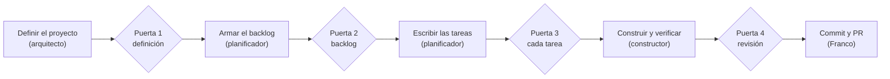

# task-03 — README: uso con el flujo, los roles y su diagrama
repo: Flucastr.AI   depende_de: task-02   estado: hecha

## Descripción
El README explica el flujo en un solo párrafo largo (`## Flujo`) y no muestra cómo se usa el kit. Esta tarea agrega la sección `## Cómo se usa`, con el paso a paso, una tabla de roles y un diagrama Mermaid de las cuatro puertas, y quita de `## Flujo` la frase obsoleta sobre F04. No cambia el comportamiento del kit.

## Contexto
- A tocar (único archivo): `README.md`. Tras `task-02` tiene `## La idea`, `## Para qué existe`, `## Reglas`, `## Documentación`, `## Estructura`, `## Instalación`, `## Pruebas`, `## Flujo`… La sección nueva va justo antes de `## Estructura`.
- Hechos que se resumen (leídos): `definitions/WORKFLOW.md` §1 (cuatro puertas: definición, backlog, cada tarea, revisión), §2 (tabla de roles), §3 (el `coordinador` decide el paso según lo que falta), §9.1 (rama por feature), §9.2 (refinado), §9.3 (yolo).
- Cómo se abre: `claude --agent coordinador` o `pi-coordinador`, desde la carpeta del proyecto (README actual, sección `## Instalación`, última viñeta).
- Comprobación que exige el README: `pruebas/comprobaciones/readme-estructura.mjs` toma el primer bloque de código **después** de la línea exacta `## Estructura`; por eso el diagrama Mermaid va en una sección anterior y no se mueve nada dentro de `## Estructura`.
- No hay `mmdc` en este equipo (`which mmdc` vacío): el Mermaid no se puede renderizar aquí; se valida por forma (ver *Verificación*) y Franco lo ve en GitHub.

## Decisiones ya tomadas
- Texto exacto de la sección nueva, que se inserta entre `## Documentación` y `## Estructura`, con una línea en blanco antes y después:
````
## Cómo se usa

1. Instalo el kit (ver [Instalación](#instalación)) y abro el coordinador desde la carpeta de mi proyecto: `claude --agent coordinador` o `pi-coordinador`.
2. El `coordinador` mira qué falta y delega: sin definición llama al `arquitecto`; con definición aprobada y sin backlog, al `planificador`; con tareas aprobadas, al `constructor`.
3. Me detiene en cuatro puertas y ahí reviso y apruebo. Lo que decido queda escrito en `definitions/STATUS.md`.
4. Los commits, el PR y el despliegue los hago yo.



| Rol | Qué hace | Qué no hace |
|---|---|---|
| `coordinador` | Es el único que abro; decide el paso siguiente, delega y se detiene en las puertas. | Construir. |
| `arquitecto` | Define el proyecto, sus repos y su arquitectura. | Planificar o construir. |
| `planificador` | Escribe el backlog y descompone cada feature en tareas completas y acotadas. | Construir o aprobar. |
| `constructor` | Ejecuta una tarea aprobada, la verifica y deja la evidencia. | Marcar `hecha`, hacer commit, push, PR, merge o despliegue. |

Detalle del flujo, de la rama por feature, del refinado y del modo yolo en [`definitions/WORKFLOW.md`](definitions/WORKFLOW.md) y en la sección [Flujo](#flujo).
````
  (En el archivo va el contenido, sin las cuatro comillas invertidas externas; el bloque interno es ```` ```mermaid ```` con tres comillas invertidas.)
- En `## Flujo`, borrar solo esta frase, con el espacio que la sigue: `F04 dejó este README al día y una comprobación que falla si el árbol de \`## Estructura\` no coincide con \`agentes/\` y \`skills/\` (\`pruebas/comprobaciones/readme-estructura.mjs\`); su cierre en \`definitions/BACKLOG.md\` lo hago yo.` (las comillas invertidas son simples; el resto del párrafo queda igual). La comprobación ya se menciona en `## Estructura` desde `task-02`.

## Alcance / Fuera de alcance
Alcance: insertar `## Cómo se usa` y borrar la frase de F04 en `## Flujo`.
Fuera de alcance: instalación, estructura, reglas, bitácora, otros diagramas (`task-04`), `definitions/`, cualquier archivo que no sea `README.md`; reescribir el resto de `## Flujo`.

## Pasos
1. En `README.md`, localizar la línea `## Estructura` y confirmar que justo antes está `## Documentación` con su contenido.
2. Insertar antes de `## Estructura` la sección `## Cómo se usa` con el contenido exacto de *Decisiones ya tomadas*.
3. En `## Flujo`, borrar la frase de F04 indicada.
4. Ejecutar *Verificación* y pegar la salida en *Evidencia*.

## Criterios de aceptación
1. `grep -n "^## " README.md` lista `Cómo se usa` entre `Documentación` y `Estructura`.
2. El README contiene exactamente un bloque ```` ```mermaid ```` que empieza con `flowchart LR` y los fences están balanceados (el comando de *Verificación* imprime `fences ok` y `mermaid: 1`).
3. La tabla de roles tiene cuatro filas de datos (comando: `grep -c "^| \`\(coordinador\|arquitecto\|planificador\|constructor\)\`" README.md` imprime `4`).
4. `grep -c "F04 dejó este README" README.md` imprime `0`.
5. `node --test pruebas/comprobaciones/readme-estructura.test.mjs` termina con `ℹ fail 0`.

## Verificación
```
cd /Users/franco/Codes/flucastr/Flucastr.AI
grep -n "^## " README.md
node -e 'const t=require("fs").readFileSync("README.md","utf8");const n=(t.match(/^```/gm)||[]).length;console.log(n%2===0?"fences ok":"fences DESBALANCEADOS");console.log("mermaid: "+(t.match(/^```mermaid\n/gm)||[]).length);console.log(/```mermaid\nflowchart LR/.test(t)?"flowchart LR ok":"sin flowchart LR")'
grep -c "^| \`\(coordinador\|arquitecto\|planificador\|constructor\)\`" README.md
grep -c "F04 dejó este README" README.md
node --test pruebas/comprobaciones/readme-estructura.test.mjs 2>&1 | grep -E "^ℹ (pass|fail)"
```
Salida esperada: `Cómo se usa` entre `Documentación` y `Estructura`; `fences ok`, `mermaid: 1`, `flowchart LR ok`; `4`; `0`; `ℹ fail 0`. Sin renderizador de Mermaid en este equipo: la sintaxis del diagrama no se puede ejecutar aquí (no ejecutado, inferido); Franco la revisa en la vista de GitHub o en un editor con vista previa Mermaid.

## Evidencia

Rama verificada antes de editar: `git branch --show-current` → `chore/F15-actualizar-readme` (sin `switch`, según el encargo).

Comando `grep -n "^## " README.md` (salida real):
```
9:## La idea
15:## Para qué existe
19:## Reglas
28:## Documentación
38:## Cómo se usa
66:## Estructura
101:## Instalación
165:## Pruebas
174:## Flujo
178:## Registro de eventos
188:## Archivo y rescate
192:## Bitácora
```

Comando de fences y mermaid (salida real):
```
fences ok
mermaid: 1
flowchart LR ok
```

`grep -c "^| \`\(coordinador\|arquitecto\|planificador\|constructor\)\`" README.md` → `4`

`grep -c "F04 dejó este README" README.md` → `0`

`node --test pruebas/comprobaciones/readme-estructura.test.mjs 2>&1 | grep -E "^ℹ (pass|fail)"` (salida real):
```
ℹ pass 7
ℹ fail 0
```

Criterios de aceptación:
1. Cumple: `Cómo se usa` aparece entre `Documentación` (28) y `Estructura` (66).
2. Cumple: `fences ok`, `mermaid: 1`, `flowchart LR ok`.
3. Cumple: `4` filas de rol.
4. Cumple: `0` ocurrencias de la frase de F04.
5. Cumple: `ℹ fail 0`.

No ejecutado: render del Mermaid (`which mmdc` → sin salida; no hay renderizador en el equipo). La sintaxis queda validada solo por forma; Franco la revisa en la vista de GitHub.

## Notas
- Cambios en `README.md` solo: se insertó `## Cómo se usa` con el texto exacto de *Decisiones ya tomadas* (entre `## Documentación` y `## Estructura`, con línea en blanco antes y después) y se borró de `## Flujo` la frase de F04 con su espacio final. El resto de `## Flujo` no se tocó.
- Sin huecos menores: la tarea trae el texto exacto y la verificación era ejecutable tal cual.
- Los cambios sin commit previos del árbol (`definitions/STATUS.md`, `task-02`) no se tocaron.
- Estado de la tarea: `en curso` al empezar y `lista para revisión` al terminar; no se marcó `hecha`.
Registro: n=1; herramienta=claude-code; modo=normal; intentos=1; verificacion=pasa; huecos=0; resultado=lista; causa=ninguna
