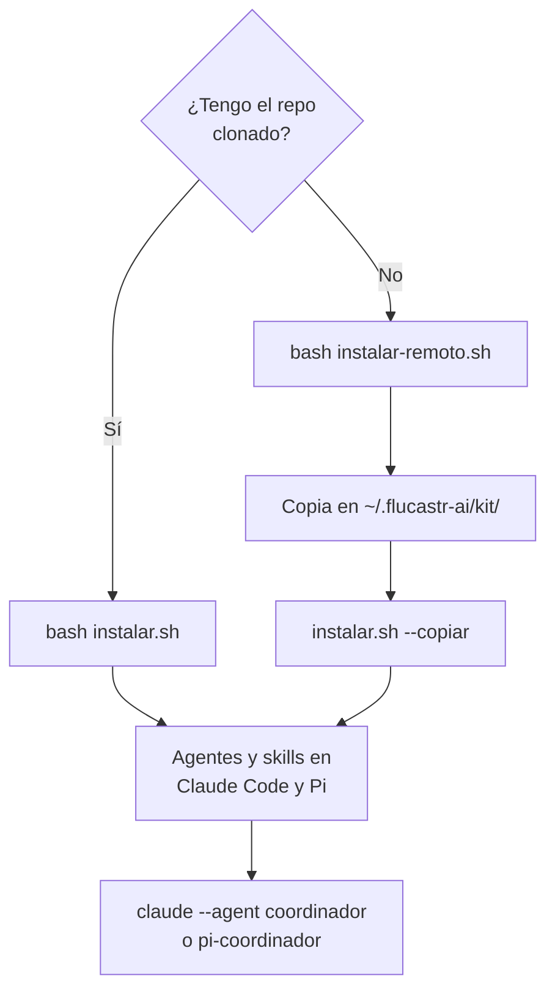

# task-04 — README: instalación local y sin clonar, con diagrama
repo: Flucastr.AI   depende_de: task-03   estado: aprobada

## Descripción
`## Instalación` ya explica los dos caminos, pero no dice de entrada cuál usar ni los muestra juntos. Esta tarea agrega al inicio de la sección una guía de elección y un diagrama Mermaid de los dos caminos, y títulos para separar «con el repo clonado» de «sin clonar». Los comandos y las viñetas existentes no cambian.

## Contexto
- A tocar (único archivo): `README.md`. La sección `## Instalación` abre con un bloque de comandos (`bash instalar.sh --simular`, `bash instalar.sh`, `bash desinstalar.sh`, `--proyecto`) seguido de viñetas, y luego `### Sin clonar el repo (PC de trabajo)` con `instalar-remoto.sh` y `#### Comprobación manual en el PC de trabajo`.
- Comandos confirmados: `bash instalar.sh --simular` ejecutado en la planificación (valida y no escribe; termina con «Listo. Reinicia Claude Code y Pi.»); opciones de `instalar-remoto.sh` leídas en el script: `--estado`, `--actualizar`, `--ref`.
- Hechos del instalador remoto (leídos en el README y en `instalar-remoto.sh`): copia solo `agentes/`, `skills/`, `scripts/`, `instalar.sh`, `desinstalar.sh`, `instalar-remoto.sh` y `modelos.json` a `~/.flucastr-ai/kit/`; guarda `~/.flucastr-ai/version`; `~/.flucastr-ai/modelos.json` nunca se pisa.
- El README sigue sujeto a `readme-estructura.mjs` (primer bloque de código tras `## Estructura`); esta sección es posterior y el cambio no lo toca.
- Sin `mmdc` en el equipo: el Mermaid se valida por forma.

## Decisiones ya tomadas
- Justo bajo el encabezado `## Instalación` (antes del bloque bash existente) insertar, con líneas en blanco entre piezas:
````
Hay dos caminos: **con el repo clonado** (mi equipo principal) y **sin clonar** (el PC de trabajo, donde no tengo clon). Los dos terminan igual: agentes y skills instalados para Claude Code y Pi.



### Con el repo clonado
````
  (Se inserta el contenido sin las cuatro comillas invertidas externas; el bloque interno es ```` ```mermaid ```` con tres.)
- El bloque bash y las viñetas existentes de la sección quedan inmediatamente después del encabezado `### Con el repo clonado`, sin cambios. `### Sin clonar el repo (PC de trabajo)` queda como está.
- No se modifican los comandos, las rutas ni las viñetas existentes.

## Alcance / Fuera de alcance
Alcance: texto de apertura, diagrama y el encabezado `### Con el repo clonado` en `## Instalación`.
Fuera de alcance: cambiar o reordenar comandos y viñetas existentes, `## Estructura`, `## Cómo se usa`, `## Pruebas`, la comprobación manual, `definitions/`, scripts de instalación y cualquier archivo que no sea `README.md`.

## Pasos
1. En `README.md`, ubicar `## Instalación` y el bloque bash que le sigue.
2. Insertar entre ambos el contenido exacto de *Decisiones ya tomadas*.
3. Confirmar que `### Sin clonar el repo (PC de trabajo)` y todo lo posterior no cambió.
4. Ejecutar *Verificación* y pegar la salida en *Evidencia*.

## Criterios de aceptación
1. Hay exactamente dos bloques ```` ```mermaid ```` en el README y los fences están balanceados (el comando de *Verificación* imprime `fences ok` y `mermaid: 2`).
2. Los comandos y viñetas de `## Instalación` siguen presentes: `grep -c "bash instalar.sh --simular\|bash instalar-remoto.sh --estado\|--proyecto /ruta/al/proyecto" README.md` imprime 3 o más.
3. `grep -n "^### " README.md` lista `Con el repo clonado` antes de `Sin clonar el repo (PC de trabajo)`.
4. Los comandos citados en el diagrama existen: `grep -c "copiar" instalar.sh instalar-remoto.sh` muestra más de 0 en ambos archivos.
5. Las comprobaciones que tocan lo de esta tarea pasan: `node --test pruebas/comprobaciones/readme-estructura.test.mjs pruebas/comprobaciones/coherencia-features.test.mjs pruebas/comprobaciones/formato-tarea.test.mjs` termina con `ℹ fail 0`. Excepción conocida y fuera de la tarea: `formato-flujo.test.mjs` (caso «BACKLOG.md real cumple el formato») falla mientras la marca `→` esté en F15 en vez de F11 (el validador exige `→` en la primera feature no `hecha`); lo resuelve Franco, no el constructor.

## Verificación
```
cd /Users/franco/Codes/flucastr/Flucastr.AI
grep -n "^## \|^### " README.md
node -e 'const t=require("fs").readFileSync("README.md","utf8");const n=(t.match(/^```/gm)||[]).length;console.log(n%2===0?"fences ok":"fences DESBALANCEADOS");console.log("mermaid: "+(t.match(/^```mermaid\n/gm)||[]).length)'
grep -c "bash instalar.sh --simular\|bash instalar-remoto.sh --estado\|--proyecto /ruta/al/proyecto" README.md
grep -c "copiar" instalar.sh instalar-remoto.sh
node --test pruebas/comprobaciones/readme-estructura.test.mjs pruebas/comprobaciones/coherencia-features.test.mjs pruebas/comprobaciones/formato-tarea.test.mjs 2>&1 | grep -E "^ℹ (pass|fail)"
git status --short
```
Salida esperada: `Con el repo clonado` antes de `Sin clonar el repo (PC de trabajo)`; `fences ok`, `mermaid: 2`; un conteo ≥ 3 y luego conteos > 0; `ℹ fail 0`; `git status` sin archivos fuera de `README.md`, `assets/`, `definitions/` y `features/F15-actualizar-readme/`. Planificación: la rápida completa hoy falla en `formato-flujo` por la marca `→` en F15 (ejecutado) y esa falla no es de esta tarea; las tres comprobaciones del criterio 5 pasan hoy (ejecutado, 31 pasan). Mermaid sin renderizar en el equipo: lo revisa Franco en GitHub.

## Evidencia

## Notas
